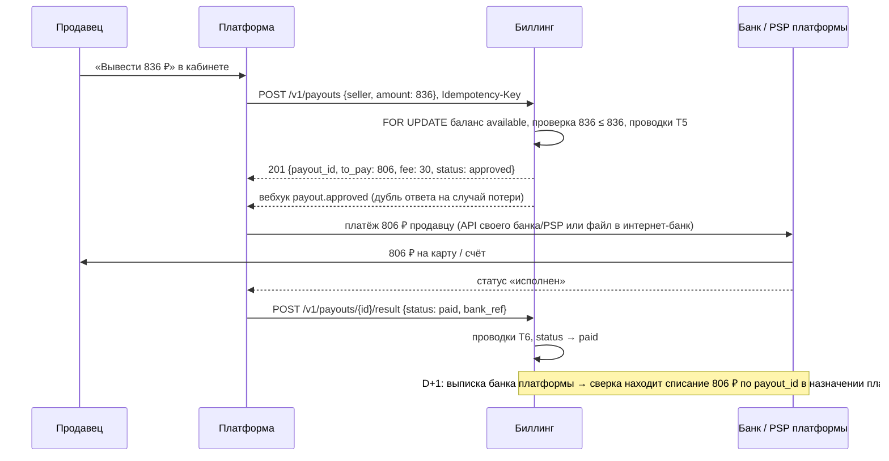
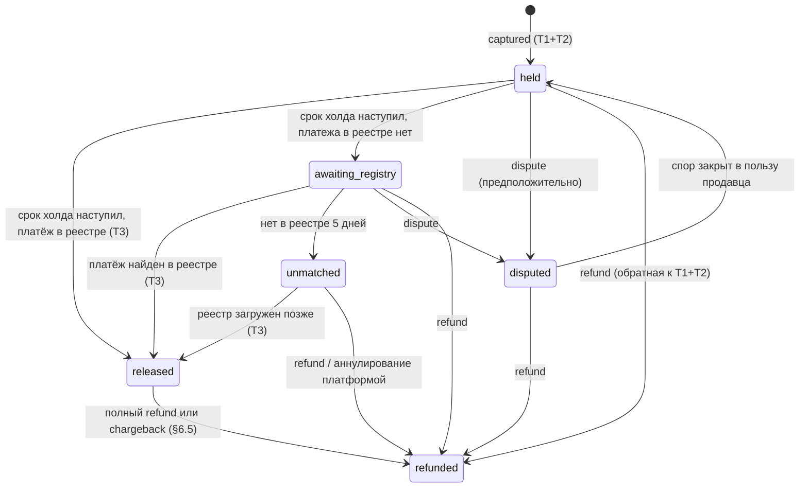
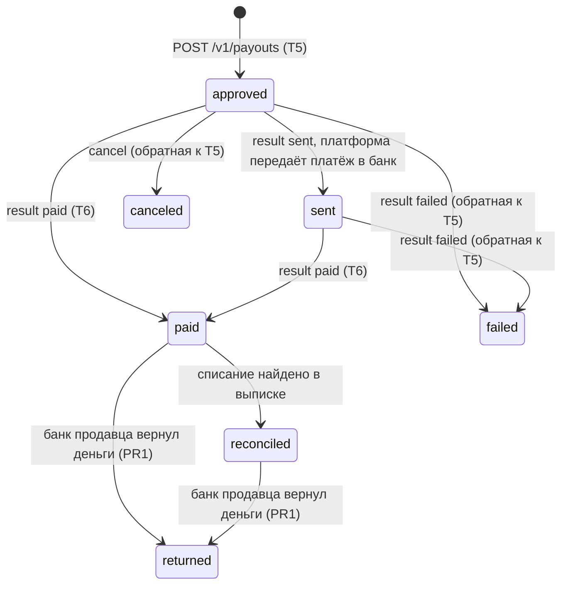
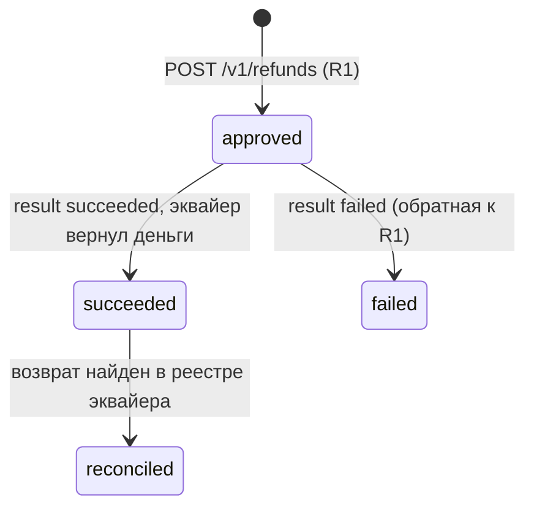
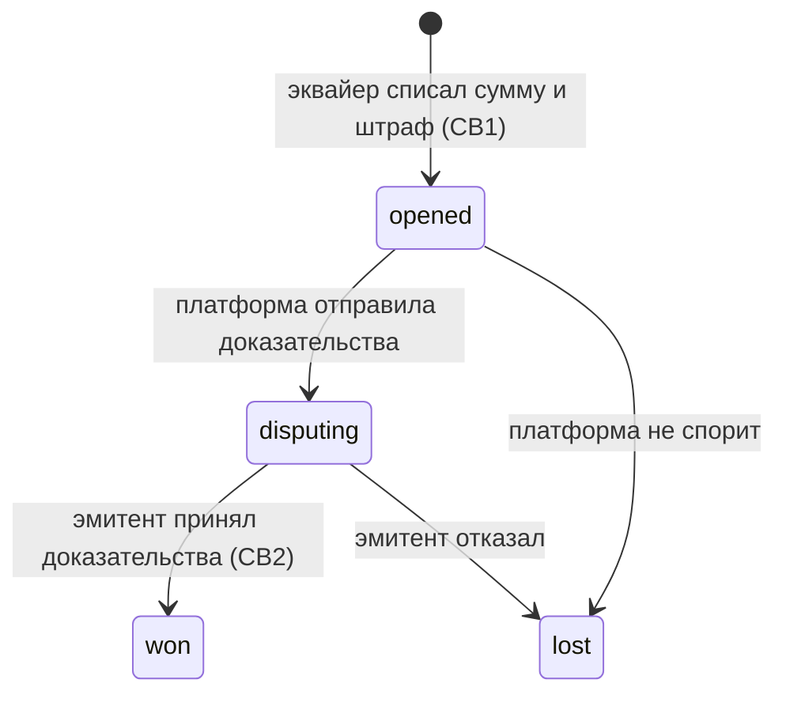

# 03. Верхнеуровневый дизайн (v0)

Здесь только основные решения. Альтернативы и запасные варианты (модульный монолит, приём платежей биллингом, сравнение брокеров) — в `04-alternatives.md`.

## 1. Цели и не-цели

**Цели**

- Для каждой продажи детерминированно разложить номинал на доли участников и сохранить это разложение навсегда.
- Вести балансы продавцов: в холде, доступно, в резерве, выводится.
- Проводить выплаты, возвраты и chargeback без потери и задвоения денег.
- Сверяться с банком и с системой платформы.
- Быть источником данных для чеков (54-ФЗ) и актов сверки с продавцами, которые уходят в ФНС (289-ФЗ).
- Быть **продуктом для нескольких платформ** (мультиарендность): наша платформа — первая, потом биллинг продаётся другим компаниям.

**Зачем платформе сторонний биллинг, если деньги и банк у неё свои.** Банк умеет только двигать деньги по команде. Решить, **какую** команду дать, — и есть сложная часть, её продаёт биллинг:

- **разложение цены** по тарифу: комиссии эквайера и платформы, резерв, комиссия за вывод, с версиями тарифов и уведомлением за 15/45 дней (289-ФЗ, ст. 12);
- **балансы продавцов по состояниям**: в холде, доступно, в резерве, выводится. Банк видит одну сумму на номинальном счёте, а не 100 000 продавцов по отдельности;
- **защита от двойного вывода и потери денег**: идемпотентность, блокировки, double-entry, неизменяемые проводки, аудит;
- **возвраты и chargeback** после выплаты: из чего удержать, долг продавца, списание из резерва;
- **ежедневная сверка** с реестром эквайера и выпиской банка;
- **документы**: данные для чеков 54-ФЗ с признаком агента, акты сверки с продавцами для 289-ФЗ, выгрузка в 1С.

Это месяцы работы сильной команды (моя оценка — от полугода) и постоянная ответственность за ошибки в деньгах. Платформа покупает готовое вместо того, чтобы строить своё (buy vs build). Мировые аналоги учётной части без движения денег: Modern Treasury Ledgers, Formance. Небольшой платформе с простым тарифом биллинг не нужен, ей хватит таблицы в своей БД. Ценность растёт с числом продавцов, сложностью тарифа и регуляторикой.

**Не-цели v0**: полноценная бухгалтерия юрлица (план счетов РСБУ, это выгрузка в 1С), мультивалютные балансы продавцов, кредитование, приём платежей самим биллингом (это v2, см. 04).

## 2. Нагрузка

Оценка для первой платформы (нашей). Каждая новая платформа добавляет свою долю.

| Метрика | Расчёт | Оценка |
|---|---|---|
| Продаж в день | PM назвал «сотни тысяч», берём верхнюю границу с запасом | **500 000** |
| Средняя нагрузка на запись | 500 000 продаж / 86 400 секунд в сутках | ≈ **5.8 продажи в секунду** |
| Пик | 5.8 × 20, где 20 — допущение: во время распродаж и вечером трафик в 10–20 раз выше среднего | ≈ **116 продаж в секунду** |
| Ledger-транзакций на продажу | T1+T2 (оплата и комиссии, одна транзакция) + T3 (снятие холда) + T4 (деньги от банка) + T7 (освобождение резерва). Выплаты (T5, T6) объединяют много продаж, на одну продажу их доля ≈ 0 (см. §5.2) | **4** |
| Проводок (строк `postings`) на продажу | T1: 3 + T2: 4 + T3: 3 + T4: 2 + T7: 2 | **14** |
| Проводок в день | 500 000 продаж × 14 строк | ≈ **7 млн** |
| Проводок в год | 7 млн × 365 дней | ≈ **2.6 млрд** |

Вывод: по записи это **один primary PostgreSQL** без шардинга. Проблемы будут в другом:

- объём `postings`: партиционирование по месяцу, старые партиции уходят в холодное хранилище (§3.8);
- **горячие счета** платформы (каждая продажа пишет в «доход комиссии»), см. §7;
- корректность при ретраях и параллельных событиях.

## 3. Архитектура

### 3.1. Граница системы

- Платформа и биллинг — **два разных проекта**: разные репозитории, команды, деплои и базы данных.
- Биллинг — **мультиарендный B2B-сервис** (SaaS). Первой его использует наша платформа, дальше его продают другим платформам.
- **Терминология:** в этом документе **платформа** = клиент биллинга (tenant), магазин цифровых товаров: через неё свои цифровые товары продают её клиенты — продавцы цифровых товаров. **Продавец** = продавец цифровых товаров, клиент платформы. Продавец с биллингом напрямую не работает: он видит кабинет платформы.
- Шины событий в компании нет, проект с нуля.
- **Приём платежей остаётся у платформы**. Биллинг получает от неё факты («оплата прошла», «заказ закрыт», «возврат»), считает, ведёт учёт и выплаты, сверяется с банком. Почему так и что будет в v2 — §3.4.

### 3.2. Интеграция: API и вебхуки, а не общая шина

Внешняя компания не станет подключаться к нашему брокеру сообщений: это чужая сеть и доступы, изоляция платформ друг от друга, а версия брокера и формат сообщений становятся частью продукта. Платёжные и учётные SaaS (Stripe, Modern Treasury, ЮKassa) интегрируются одинаково, и мы делаем так же:

- **входящие команды и чтение** — публичный HTTP API (REST, `/v1/...`) с обязательным `Idempotency-Key`;
- **исходящие события** — вебхуки: HTTP-запросы на URL платформы, подписанные HMAC её секретом, с повторами.

Наша платформа интегрируется **так же, как будущие внешние платформы** (dogfooding). Второй, внутренний путь (например, через RabbitMQ) означал бы два контракта на одну функцию, и тот, которым пользуются внешние платформы, никто бы не проверял на себе.

Брокер внутри биллинга — деталь реализации, платформы его не видят. На старте его нет (§3.7).

### 3.3. Схема


Принципы:

- **Каждый вход идемпотентен.** Повтор API-запроса с тем же `Idempotency-Key` возвращает исходный результат. Повтор вебхука платформа отсекает по `event_id` (inbox).
- **Transactional outbox на обеих сторонах.** Платформа пишет «вызвать биллинг» в свой outbox в одной транзакции с оплатой. Биллинг пишет вебхуки и задачи в свой outbox в одной транзакции с проводками.
- Redis **не участвует в деньгах**. Источник истины — только PostgreSQL биллинга. Redis можно использовать для кеша и rate-limit.

### 3.4. Приём платежей: у платформы

Платёжную форму, интеграцию с эквайером и вебхуки банка держит платформа. Биллинг учитывает факты, которые она передаёт, и проверяет их сверкой с реестром её эквайера (§6.3).

Почему так для v1:

- биллинг не принимает деньги покупателей, поэтому не становится платёжным агентом (меньше регуляторики) и не попадает в PCI DSS;
- платформа оставляет своего эквайера и договор с банком, продукт проще продать;
- если биллинг недоступен, продажи не останавливаются: вызовы копятся в outbox платформы.

Чем платим за это:

- биллинг **верит платформе** до сверки. Поэтому деньги продавцу разблокируются только после того, как платёж найден в реестре эквайера (§6.3);
- деньги лежат на счёте платформы (номинальном, ст. 860.1 ГК: счёт открыт на неё, но деньги принадлежат продавцам-бенефициарам), и **выплаты исполняет сама платформа** (ниже). Биллинг не получает доступа к её банку.

Приём платежей самим биллингом (биллинг как платёжный шлюз) — v2. Полное сравнение обоих вариантов (плюсы, минусы, подводные камни) — `04-alternatives.md` §2. Вариант, где биллинг сам вызывает API банка платформы по выданному ключу, — `04-alternatives.md` §6.

#### Выплаты: биллинг решает, платформа платит

Разделение ролей:

- **биллинг** — решает, **можно ли и сколько** выплатить: проверяет доступный баланс под блокировкой, считает комиссию за вывод, пишет проводки, не даёт вывести дважды, сверяет итог с выпиской;
- **платформа** — **двигает деньги**: отправляет платёж из своего банка или через своего PSP выплат и сообщает результат;
- **банк платформы** — ничего не знает о биллинге.

Путь денег и команд на примере из §4 (у продавца доступно 836 ₽, он выводит всё):



Значения: 836 ₽ — доступный баланс продавца после холда и резерва (§4); 30 ₽ — комиссия за вывод, `max(836 × 1% = 8.36, 30) = 30`; 806 ₽ = 836 − 30 — сколько реально уходит продавцу из банка платформы.

Статусы выплаты в биллинге: `approved → sent → paid | failed`, `approved → canceled`, плюс `reconciled` после сверки с выпиской. Полная схема переходов и таймауты — §6.4.

- **`approved`** — деньги списаны с `seller:available` (T5): 836 ₽ ушли в `payout_in_transit` (806) и `revenue:payout_fee` (30). Второй вывод тех же денег невозможен.
- **`sent`** — платформа сообщила, что передаёт платёж в банк. После этого отменить выплату нельзя.
- **`canceled`** — платформа отменила выплату до отправки в банк: обратная к T5, 836 ₽ возвращаются в `available`.
- **`paid`** — платформа сообщила, что банк исполнил платёж: T6 (`payout_in_transit` → `bank_settlement`).
- **`failed`** — банк отклонил (неверные реквизиты, лимиты): платформа шлёт `result {status: failed}`, биллинг пишет обратную к T5 транзакцию, 836 ₽ возвращаются в `available`.
- **`reconciled`** — списание найдено в выписке банка платформы. Если выплата `paid`, а в выписке её нет через N дней, или наоборот, — расхождение, алерт обоим (§6.3).
- Если платформа долго не присылает результат — алерт платформе (сроки в §6.4), деньги остаются в `payout_in_transit` (не возвращаются продавцу автоматически: платёж мог уйти).

Как платформа может исполнять выплаты (её выбор, биллингу всё равно):

| Способ | Скорость | Что нужно от продавца | Примечание |
|---|---|---|---|
| API своего банка (номинальный счёт, «безопасная сделка») | Минуты | Карта, телефон СБП или счёт | Ключ к банку остаётся у платформы |
| API PSP выплат (ЮKassa Выплаты и т.п.) | Минуты | Карта или телефон СБП | Платформа пополняет баланс PSP переводом из своего банка; можно ли с номинального счёта — уточнять у банка |
| Пакетом: файл платёжек `1CClientBankExchange` из биллинга (`GET /v1/payout-batches/{id}/file`) | 1–2 рабочих дня | Счёт и БИК | Работает с любым банком РФ. Бухгалтер подписывает пачку в интернет-банке или 1С:ДиректБанк. Результат платформа присылает по выписке или биллинг ставит `paid` сам при сверке |

Комиссия за вывод (30 ₽) остаётся на счёте платформы: это её доход (`revenue:payout_fee`), а расходы на переводы (тарифы банка или PSP) платформа несёт сама, биллинг их учитывает, если она их передаёт.

### 3.5. Мультиарендность

| Аспект | Решение |
|---|---|
| Изоляция данных | `tenant_id` в каждой таблице и в каждом ключе уникальности (`unique (tenant_id, idempotency_key)`). PostgreSQL Row-Level Security как вторая линия защиты от ошибки в коде. Крупная платформа может получить отдельную БД (cell) |
| Аутентификация | API-ключ (или OAuth client credentials) на платформу. Ключ определяет `tenant_id`, платформа не передаёт его сама |
| Тарифы | Свои версии тарифов у каждой платформы (комиссия платформы — её собственная настройка, а не биллинга) |
| Счета платформы | `revenue:commission` и другие — свои у каждой платформы |
| Доход самого биллинга | Плата платформы за SaaS — отдельный счёт `billing_fee` в её журнале или отдельное выставление счетов, решается бизнес-моделью |
| Лимиты | Rate limit на платформу, чтобы одна платформа не положила остальные |
| Персональные данные | Данные продавцов (ФИО, ИНН, реквизиты) принадлежат платформе, биллинг обрабатывает их по поручению (152-ФЗ). Это нужно предусмотреть в договоре и в хранении |

### 3.6. Баланс продавца в кабинете платформы

Платформа держит у себя **копию балансов только для показа** (read model). Кабинет не нагружает биллинг и работает, даже если биллинг недоступен.

- Биллинг шлёт вебхук `seller.balance.updated { seller_id, pending, available, reserve, debt, version, as_of }` **только при изменении** баланса, схлопывая изменения одного продавца за окно в 5 секунд (допущение).
- `version` растёт с каждой проводкой по счетам продавца. Платформа сохраняет, только если версия новее: `UPDATE ... WHERE version < :new`. Так вебхук, пришедший не по порядку, не затрёт свежий баланс.
- Раз в сутки — сверка копии по полному снимку; для догоняющей синхронизации есть `GET /v1/balances?updated_since=...`.
- Кабинет показывает «обновлено N секунд назад».
- **Решения по копии не принимаются.** Вывод денег — синхронный `POST /v1/payouts`, где баланс проверяется под блокировкой строки (§6.2). Расчёт «вы получите X ₽» при выставлении цены — синхронный `POST /v1/quotes`.

**Объём вебхуков** (значения из §2):

| Что | Расчёт | Результат |
|---|---|---|
| Изменений баланса на продажу | T1+T2 (начисление в холд), T3 (снятие холда), T7 (освобождение резерва) | 3 |
| Изменений в сутки | 500 000 продаж × 3 | 1 500 000 |
| Средний поток | 1 500 000 / 86 400 секунд в сутках | ≈ 17 вебхуков в секунду |
| Со схлопыванием | Активный продавец с 10 продажами за 5 секунд получит 1 вебхук вместо 30 | Меньше, особенно на пике |

### 3.7. Согласованность двух систем

| Проблема | Решение |
|---|---|
| Платформа записала оплату, а вызов `POST /v1/sales/captured` не дошёл (сеть, биллинг недоступен) | Вызов — задача в outbox платформы, повторяется до успеха. `Idempotency-Key = sale_id`, повтор безопасен |
| Вебхук не дошёл до платформы | Биллинг повторяет с экспоненциальной задержкой (например, до 3 суток), затем помечает как недоставленный. Есть `GET /v1/events?since=` и повторная отправка по API |
| Подделка вебхука | Подпись HMAC и метка времени в заголовке, проверка на стороне платформы, отказ при старой метке (защита от повтора) |
| Расхождение «платформа ↔ биллинг» | Отдельная пара в ежедневной сверке (§6.3) |
| Изменение контракта | Версия в URL (`/v1/`) и в схеме событий. Добавлять поля можно, удалять и менять смысл — только в новой версии |
| Возврат (платформа отзывает ключ, биллинг списывает с продавца) | Saga: платформа вызывает `POST /v1/refunds` (биллинг проверяет и проводит, `approved`), затем возврат у эквайера, затем `result`. Отказ эквайера — компенсирующая обратная проводка, без распределённых транзакций (§6.5) |

### 3.8. Очередь внутри биллинга: PostgreSQL, без брокера

Гарантии дают **outbox, inbox и идемпотентность**, а не брокер. Поэтому на старте роль очереди выполняет PostgreSQL биллинга:

- `outbox` — вебхуки и внутренние события. Worker читает их через `SELECT ... FOR UPDATE SKIP LOCKED`, поэтому несколько воркеров не берут одну и ту же строку;
- `jobs` с колонкой `run_at` — задачи: отправить выплату, пробить чек, доставить вебхук, периодические «дворники», которые снимают истёкшие холды и освобождают резервы. Готовые библиотеки: pg-boss, graphile-worker;
- нагрузка: ~116 событий в секунду на пике (§2) плюс вебхуки и задачи. Для PostgreSQL это мало.

Сравнение с Kafka, RabbitMQ, BullMQ и условия, при которых брокер понадобится, — в `04-alternatives.md`.

**Размер базы и размер очереди не связаны.** Миллиарды строк копятся в `postings` (журнал хранится вечно). В таблицах очереди лежит только **ещё не обработанная** работа, а обработанные строки удаляются. Скорость очереди зависит от числа живых строк в её таблице и от мусора (dead tuples), а не от размера базы.

**Сколько строк живёт в очереди.** Число строк, которые одновременно лежат в очереди, = (сколько задач приходит в секунду) × (сколько секунд каждая ждёт). Это закон Литтла: `L = λ × W`, где `λ` — поток задач, `W` — время ожидания одной задачи, `L` — сколько задач в очереди в любой момент. Значения из §2:

| Что | λ (поток) | W (ждёт) | L = λ × W (строк в очереди постоянно) |
|---|---|---|---|
| Немедленные события (`outbox`): вебхуки, чеки | 116 событий/с на пике | ~5 с, пока worker не разберёт | 116 × 5 ≈ **580** |
| Освобождение резерва, **если** на каждую продажу ставить отложенную задачу «освободить через 30 дней» | 500 000 продаж/день | 30 дней резерва (§4) | 500 000 × 30 = **15 000 000** |
| То же для снятия холда | 500 000 продаж/день | 1 день холда (допущение) | 500 000 × 1 = **500 000** |

То есть 15 млн — это не нагрузка, а **наивный вариант дизайна**, который я отбрасываю: каждая продажа создаёт задачу с `run_at = now() + 30 дней`, и задача 30 дней лежит в `jobs`, пока не наступит её время. Новые приходят каждый день, поэтому в таблице постоянно ~15 млн ожидающих задач.

Почему это плохо:

- `jobs` — самая «горячая» таблица: в неё постоянно пишут и из неё постоянно забирают. Из 15 млн строк готовы к работе единицы, остальные 30 дней просто занимают место в индексе, по которому опрашивают воркеры, и в работе vacuum;
- задача дублирует данные, которые и так лежат в учёте (сумма резерва, продавец), и может с ними разойтись;
- при возврате или chargeback до конца резерва задачу нужно найти и отменить, иначе через 30 дней она освободит уже списанные деньги;
- 500 000 задач в день — это 500 000 отдельных транзакций освобождения вместо пачек.

**Что делаем вместо этого — «дворник».** Дата освобождения уже есть в данных продажи: `sale_breakdowns.hold_until` и `sale_breakdowns.reserve_release_at` (+ ссылки на транзакции, которые их сняли). Отдельная задача на продажу не нужна:

```sql
-- индекс только по ещё не освобождённым резервам: маленький и быстрый
create index on sale_breakdowns (reserve_release_at)
  where reserve_released_tx is null;

-- раз в минуту одна периодическая задача:
select id from sale_breakdowns
where reserve_released_tx is null and reserve_release_at <= now()
order by reserve_release_at
limit 1000
for update skip locked;
-- для пачки: проводки T7 и reserve_released_tx = id транзакции, в одной DB-транзакции
```

Что это даёт:

- в `jobs` остаются только немедленные задачи (выплаты, чеки, вебхуки) — сотни строк, а не миллионы;
- 15 млн ожидающих резервов никуда не исчезают, но живут там, где и так должны жить, — в учётной таблице, а не в очереди. Это данные, а не работа: их не опрашивают каждую секунду, и они не создают мусора от постоянной вставки и удаления;
- отмена при возврате — это просто проводки возврата и пометка в той же строке, искать задачу не нужно;
- пачка 1 000 освобождений за одну транзакцию. Сколько нужно: 500 000 резервов в день / 1 440 минут ≈ 347 в минуту, то есть одна пачка в минуту с запасом в 3 раза;
- если дворник упал на час, ничего не теряется: следующий запуск заберёт всё, у чего срок наступил.

**Риски и меры:**

| Риск | Почему опасен | Мера |
|---|---|---|
| Мусор от `UPDATE` и `DELETE` в таблице очереди | Каждая обработанная строка оставляет dead tuple. ~116 событий/с × 86 400 с ≈ 10 млн мёртвых строк в сутки. Пока autovacuum их не убрал, `SKIP LOCKED` сканирует мусор и замедляется | Агрессивный autovacuum **на уровне таблицы**: `autovacuum_vacuum_scale_factor = 0`, `autovacuum_vacuum_threshold = 1000` (чистить после каждой 1 000 мёртвых строк, а не после 20% таблицы по умолчанию). Ещё лучше: партиционировать `outbox` по дню и делать `DROP PARTITION` вместо `DELETE`, тогда мусора нет совсем |
| **Длинные транзакции** (тяжёлый отчёт по миллиардам проводок, забытая открытая транзакция) | Пока транзакция открыта, vacuum не может удалить **ни одну** мёртвую строку во всей базе, включая очередь. Это главная причина деградации очередей в Postgres | Отчёты и аналитика не ходят в основную базу. `idle_in_transaction_session_timeout = 60s`, `statement_timeout` для OLTP-роли. Алерт на возраст самой старой транзакции |
| Отчёты на реплике с `hot_standby_feedback = on` | Этот флаг заставляет primary держать мёртвые строки ради запросов на реплике, то есть та же проблема | Для отчётов использовать выгрузку в отдельное хранилище (ClickHouse или Parquet в S3) через CDC или ночной экспорт закрытых партиций |
| Индекс очереди | Без него каждый опрос читает всю таблицу | Частичный индекс `ON jobs (run_at) WHERE status = 'pending'`: он содержит только ожидающие задачи и всегда маленький |

**Журнал `postings` при 2.6 млрд строк в год:**

- Объём: ~170 байт на строку (~76 байт сама строка: заголовок 24 + `id` 8 + `tx_id` 16 + `account_id` 8 + `amount` 8 + `created_at` 8 + указатель 4; плюс ~3 индекса по ~30 байт). 2.6 млрд × 170 байт ≈ **440 ГБ в год**. Для одного сервера PostgreSQL это нормально.
- Партиция на месяц: 7 млн строк/день × 30 дней ≈ **210 млн строк** (~36 ГБ: 210 млн × 170 байт). Индексы каждой партиции помещаются в память, запись идёт только в текущую.
- Горячий путь (проверка баланса при выводе) журнал не сканирует, а читает `account_balances` (одна строка на счёт).
- Выписка продавца — это запрос по индексу `(account_id, created_at)` в 1–2 последних партициях.
- Закрытые старые партиции отсоединяются (`DETACH PARTITION`) и уходят в холодное хранилище, в основной базе остаётся например 12–24 месяца.

## 4. Разложение цены (fee waterfall)

### 4.1. Компоненты

| Компонент | Тип | Кто получает | Когда |
|---|---|---|---|
| Номинал `P` | — | — | Оплата |
| Сервисный сбор покупателя (опционально) | % / фикс. сверх `P` | Платформа | Оплата |
| MDR эквайринга | % от платежа (зависит от метода: карта РФ, СБП, иностранная карта) | Банк | Удерживается из расчёта банком |
| Комиссия платформы | % от `P` (по категории, уровню продавца) | Платформа | Оплата |
| Налоговое удержание (опционально) | % | Бюджет (платформа как налоговый агент) | Разблокировка |
| Резерв под chargeback | % от нетто, на N дней | Остаётся на счёте продавца, но заморожен | Разблокировка |
| Комиссия за вывод | % / мин. фикс. | Платформа | Выплата |
| Штрафы, корректировки | фикс. | Платформа | По событию |

### 4.2. Пример (тариф: MDR перекладывается на продавца)

**Входные значения** (все, кроме `P`, — допущения для примера, реальные задаёт тариф):

| Обозначение | Значение | Что это и откуда |
|---|---|---|
| `P` | 1 000.00 ₽ | Номинальная цена: продавец выставил, покупатель заплатил |
| `mdr` | 2% | Комиссия банка-эквайера за приём оплаты картой РФ. Банки рекламируют интернет-эквайринг от ~1.5%, у СБП ставка ниже, у иностранных карт выше |
| `fee` | 10% | Комиссия платформы с продажи. У конкурентов ~2–12% (§1 в 02-research) |
| `reserve` | 5% на 30 дней | Доля денег продавца, замороженная под возможные chargeback |
| `payout_fee` | 1%, минимум 30 ₽ | Комиссия платформы за вывод денег на карту (похоже на FunPay: ~3%, мин. 30 ₽) |

**Расчёт:**

| Шаг | Формула | Сумма | Остаток продавца |
|---|---|---|---|
| Покупатель заплатил | `P` | 1 000.00 | — |
| MDR банка | `P × mdr` = 1 000 × 2% | 20.00 | 1 000 − 20 = 980.00 |
| Комиссия платформы | `P × fee` = 1 000 × 10% | 100.00 | 980 − 100 = **880.00 начислено (в холде)** |
| Заказ подтверждён, холд снят | — | — | 880.00 |
| Резерв | `начислено × reserve` = 880 × 5% | 44.00 | 880 − 44 = **836.00 доступно** |
| Комиссия за вывод | `max(доступно × 1%, 30)` = max(836 × 1% = 8.36, 30) | 30.00 | 836 − 30 = **806.00 на карту** |
| Через 30 дней резерв освобождён | — | +44.00 | 44.00 доступно |

**Откуда 44 ₽.** Резерв — это 5% от суммы, причитающейся продавцу (880 × 5% = 44). Почему база 880, а не 1 000: замораживаем только деньги продавца, а комиссии банка и платформы ему и так не принадлежат. Оба числа, 5% и 30 дней, — **допущения-заглушки**, их задаёт риск-политика, а не закон. Зачем нужен резерв: покупатель может оспорить платёж через свой банк (chargeback) уже после того, как продавец вывел деньги. Для цифровых ключей частая причина — оплата украденной картой. Тогда банк спишет с платформы всю сумму плюс штраф, а взыскать её с физлица уже нельзя. Резерв оставляет часть денег продавца на счёте на время, за которое приходит основная масса chargeback. На практике параметр задаётся на продавца: у новичка выше (вплоть до 100% на 7 дней), у проверенного 0%. В v0 резерв можно вообще выключить и оставить только холд.

**Итого:**

- продавцу **850.00 ₽** = 806 (выплата сразу) + 44 (резерв позже). Из 44 ещё вычтется комиссия следующего вывода, поэтому выплаты выгодно объединять;
- платформе **130.00 ₽** = 100 (комиссия с продажи) + 30 (комиссия за вывод);
- банку **20.00 ₽** (MDR);
- проверка: 850 + 130 + 20 = 1 000 = `P`.

### 4.3. Правила расчёта

- Все суммы — `bigint` в копейках. Проценты задаются в **basis points** (1% = 100 bp).
- Округление каждого компонента делается явно (`HALF_UP` до копейки). **Остаток продавца вычисляется как разность**, а не отдельным процентом, поэтому сумма всегда сходится до копейки.
- Расчётный MDR — это **оценка**. Фактический MDR приходит в реестре банка, и разница проводится при сверке на счёт `acquiring_fee_diff`.
- Тариф **версионирован** (`tariff_versions.effective_from`). При оплате результат расчёта сохраняется в `sale_breakdowns` вместе с `tariff_version_id`, и пересчёта задним числом не бывает. Это закрывает требование 289-ФЗ уведомлять об изменениях заранее и даёт аудит.

### 4.4. Курсовая разница (покупатели из СНГ)

**Откуда берётся.** Покупатель платит в своей валюте (например, тенге) по курсу на момент оплаты. Деньги платформе в рублях приходят через 1–3 дня по курсу на момент перечисления. Если курс за это время изменился, рублей придёт больше или меньше, чем мы ожидали. Эта разница и есть курсовая.

**Кто её несёт — три сценария:**

| Сценарий | Как | Курсовая разница у платформы |
|---|---|---|
| FX-1. Покупатель платит в рублях иностранной картой | Конвертирует банк покупателя, платформа получает рубли | Нет. Только MDR для иностранных карт выше |
| FX-2. PSP фиксирует курс в момент оплаты | PSP берёт риск на себя и зашивает его в свою комиссию | Нет. Курс известен сразу |
| FX-3. Цена в валюте покупателя, курс фиксирует платформа | Платформа показывает цену в KZT по своему курсу, PSP перечисляет рубли позже по своему | **Да.** Нужен учёт |

**Главный принцип: продавца курс не касается.** Продавец выставил цену в рублях, и его доля считается от рублёвого номинала `P` в момент покупки. Валютный риск несёт платформа и закладывает в курс наценку (FX markup) как буфер.

**Пример для сценария FX-3** (MDR опущен для наглядности):

| Обозначение | Значение | Что это и откуда |
|---|---|---|
| `P` | 1 000.00 RUB | Цена продавца в рублях |
| `R1` | 5.50 KZT за 1 RUB | Курс платформы на момент оплаты (иллюстративный) |
| `markup` | 2% | Наценка платформы на курс, буфер против колебаний (допущение) |
| `R2` | 5.60 KZT за 1 RUB | Курс, по которому PSP перечислил деньги через 2 дня (тенге подешевел, иллюстративно) |

| Шаг | Формула | Результат |
|---|---|---|
| Цена для покупателя | `P × R1 × (1 + markup)` = 1 000 × 5.50 × 1.02 | **5 610.00 KZT** |
| Ожидаемые рубли по курсу оплаты | 5 610 / `R1` = 5 610 / 5.50 | 1 020.00 RUB = 1 000 (продавцу) + 20 (доход от наценки) |
| Фактически пришло | 5 610 / `R2` = 5 610 / 5.60 | **1 001.79 RUB** |
| Курсовая разница | 1 001.79 − 1 020.00 | **−18.21 RUB** (убыток платформы) |
| Итог платформы по валюте | 20 (наценка) − 18.21 (курсовая разница) | +1.79 RUB |
| Без наценки было бы | 5 500 / 5.60 = 982.14; 982.14 − 1 000 | −17.86 RUB убытка |

Продавец в любом случае получает своё от `P` = 1 000 RUB (по разложению из §4.2).

**Проводки.** Счета имеют валюту, и инвариант «сумма = 0» действует **по каждой валюте отдельно**. Валюты связываются через счёт конвертации `fx_clearing`, у которого есть ноги в обеих валютах:

| # | Событие | Проводки KZT | Проводки RUB |
|---|---|---|---|
| F1 | Оплата в KZT | `acquirer_receivable_kzt +5610`, `fx_clearing_kzt −5610` | `fx_clearing_rub +1020`, `seller:pending −1000`, `revenue:fx_markup −20` |
| F2 | PSP перечислил рубли | `fx_clearing_kzt +5610`, `acquirer_receivable_kzt −5610` | `bank_settlement +1001.79`, `fx_clearing_rub −1001.79` |
| F3 | Закрытие разницы | — | `fx_gain_loss +18.21`, `fx_clearing_rub −18.21` |

После F3 `fx_clearing` равен 0 в обеих валютах. `fx_gain_loss` показывает итог валютных операций платформы.

**Возвраты.** Покупателю возвращается исходная сумма в KZT (5 610). В рублях она стоит по курсу дня возврата, и это ещё одна курсовая разница платформы. С продавца списывается ровно то, что ему начислили (рубли от `P`).

**Что хранить:**

- `fx_rates` (пара, курс, источник, время); в `sale_breakdowns` записываются `rate_id`, валюта и сумма оплаты;
- курс хранится как `numeric` с достаточной точностью, а результат конвертации округляется до минимальной единицы валюты (`HALF_UP`);
- число знаков после запятой берётся из ISO 4217 для каждой валюты (у RUB и KZT 2, но бывают валюты с 0 или 3 знаками), а не зашивается как «копейки».

## 5. Модель ledger

### 5.1. Счета (у каждой платформы свой набор)

Счёт ledger — это **не банковский счёт**, а строка в таблице `accounts`: «корзина», в которой копится одна сумма с одним смыслом. Банковский счёт у платформы один (номинальный), а счетов ledger — миллионы: по три-четыре на каждого продавца плюс десяток системных.

Имена вида `seller:{id}:available` — запись для людей. В БД счёт — это `accounts.id` и набор полей `(tenant_id, owner_type, owner_id, kind, currency)`. Например, `seller:42:available` = `(tenant 1, seller, '42', available, RUB)`. Счёт создаётся при первой проводке на него (у продавца — при первой продаже).

Тип счёта определяет, в какую сторону он «нормально» растёт (`accounts.normal_balance`, см. дебет/кредит в 00-glossary):

- **актив** (debit) — что принадлежит платформе или что ей должны: posting с `+` его увеличивает, с `−` уменьшает;
- **обязательство** (credit) — что платформа должна другим (продавцам, банку, бюджету): posting с `−` его увеличивает, с `+` уменьшает;
- **доход** (credit) — заработок платформы: увеличивается posting'ом с `−`;
- **расход** (debit) — потери платформы: увеличивается posting'ом с `+`.

Пример: `bank_settlement +980` — денег на счёте стало на 980 больше; `seller:pending −1000` — долг продавцу вырос на 1 000; `seller:pending +100` — долг продавцу уменьшился на 100 (удержали комиссию). Знаки разные у разных типов, чтобы сумма каждой транзакции была 0: деньги пришли (+) ровно потому, что появился долг или доход (−).

| Счёт | Тип | Владелец | Смысл | В примере §5.2 |
|---|---|---|---|---|
| `seller:{id}:pending` | обязательство | продавец | Начислено, но в холде (заказ не закрыт) | T1–T2: 880, T3: 0 |
| `seller:{id}:available` | обязательство | продавец | Можно выводить. **Не может быть < 0** | T3: 836, T5: 0, T7: 44 |
| `seller:{id}:reserve` | обязательство | продавец | Резерв под chargeback | T3: 44, T7: 0 |
| `seller:{id}:debt` | актив | продавец | Продавец должен платформе (chargeback больше его денег), гасится из будущих продаж | — |
| `payout_in_transit` | обязательство | система | Выплата одобрена биллингом, платформа ещё не сообщила об исполнении | T5: 806, T6: 0 |
| `acquirer_receivable` | актив | система | Эквайер должен платформе: оплата прошла, деньги ещё не пришли на счёт | T1: 980, T4: 0 |
| `bank_settlement` | актив | система | Деньги на номинальном счёте платформы. Должен совпадать с выпиской | T4: 980, T6: 174 |
| `acquiring_fee` | транзитный | система | MDR: начисляется при оплате и сразу перевыставляется продавцу (или списывается в расход платформы, если тариф так решил) | T1: 20, T2: 0 |
| `acquiring_fee_diff` | расход | платформа | Разница между расчётным MDR и фактическим из реестра | — |
| `expense:refund_mdr`, `expense:chargeback_fee`, `expense:chargeback_loss`, `expense:bad_debt` | расход | платформа | Потери платформы на возвратах и chargeback, списанные долги продавцов (§6.5) | — |
| `platform_funding` | капитал | платформа | Пополнение номинального счёта из собственных денег платформы, когда долги продавцов съели её доход (§6.5) | — |
| `revenue:commission` | доход | платформа | Комиссия с продажи | T2: 100 |
| `revenue:payout_fee` | доход | платформа | Комиссия за вывод | T5: 30 |
| `revenue:fx_markup`, `fx_clearing_{cur}`, `fx_gain_loss` | доход / транзитный / доход или расход | платформа | Наценка на курс, конвертация, курсовая разница (§4.4) | — |
| `tax_withholding_payable` | обязательство | бюджет | Удержанный налог, если включено удержание | — |

Суммы в последней колонке — баланс счёта после указанной транзакции, в естественном знаке.

**Где используются имена счетов (не только в журнале):**

- `accounts` — справочник счетов (план счетов платформы в ledger);
- `postings` — каждая запись ссылается на `account_id`;
- `account_balances` — текущий баланс счетов продавцов;
- **API и вебхуки** — продавец и платформа видят не имена счетов, а их балансы: `GET /v1/balances` → `{pending: 0, available: 44, reserve: 0}`, вебхук `seller.balance.updated`;
- **выписка продавца и акт сверки** (§9) — проводки по его счетам с расшифровкой из `sale_breakdowns`;
- **сверка** (§6.3) — `acquirer_receivable` сравнивается с реестром эквайера, `bank_settlement` и `payout_in_transit` — с выпиской;
- **выгрузка в 1С** — каждому счёту ledger сопоставляется счёт плана счетов РСБУ платформы (таблица соответствия — её настройка, задаёт её бухгалтер; например, доходы — в 90 «Продажи», расчёты с продавцами — в 76).

### 5.2. Проводки для примера выше (дебет `+`, кредит `−`; сумма каждой транзакции = 0)

Терминология: в этом документе «проводка» в таблицах означает **posting** — запись по одному счёту. Бухгалтерская проводка «Дт X — Кт Y» — это пара таких записей (см. 00-glossary).

| # | Событие | Проводки |
|---|---|---|
| T1 | `POST /v1/sales/captured` | `acquirer_receivable +980`, `acquiring_fee +20`, `seller:pending −1000` |
| T2 | (та же DB-транзакция) комиссии | `seller:pending +100`, `revenue:commission −100`; `seller:pending +20`, `acquiring_fee −20` |
| T3 | `POST /v1/sales/{id}/complete` / таймаут холда | `seller:pending +880`, `seller:available −836`, `seller:reserve −44` |
| T4 | деньги пришли на счёт (выписка), платёж найден в реестре | `bank_settlement +980`, `acquirer_receivable −980` |
| T5 | выплата создана | `seller:available +836`, `payout_in_transit −806`, `revenue:payout_fee −30` |
| T6 | платформа сообщила, что банк исполнил выплату (`result: paid`) | `payout_in_transit +806`, `bank_settlement −806` |
| T7 | +30 дней | `seller:reserve +44`, `seller:available −44` |

Проверка инварианта (после T6, до T7):

- на счёте `bank_settlement` = 980 (пришло от банка: `P` 1 000 − MDR 20) − 806 (ушло продавцу выплатой) = **174**;
- обязательства и доходы, которые эти деньги покрывают: 44 (резерв продавца, ещё не выплачен) + 130 (доход платформы: 100 комиссии + 30 за вывод) = **174**;
- 174 = 174, деньги сходятся.

**Возвраты, chargeback, долг продавца** — §6.5: с продавца списывается из денег самой продажи, потом из `available`, остаток уходит в `seller:{id}:debt` (`available` в минус не уходит, долг гасится из будущих поступлений). Кто несёт невозвращаемый MDR и комиссию, решает тариф.
**Выплата отклонена банком** — обратная транзакция к T5.

### 5.3. Схема БД (эскиз)

```sql
create table tenants (
  id          bigserial primary key,
  name        text not null,
  status      text not null default 'active',     -- active | suspended
  created_at  timestamptz not null default now()
);

create table accounts (
  id             bigserial primary key,
  tenant_id      bigint not null references tenants(id),
  owner_type     text not null check (owner_type in ('seller', 'platform', 'system')),
  owner_id       text,                            -- id продавца в системе платформы; null у системных
  kind           text not null,                   -- pending | available | reserve | debt | bank_settlement | ...
  currency       char(3) not null default 'RUB',  -- ISO 4217
  normal_balance text not null check (normal_balance in ('debit', 'credit')),
                                                  -- debit: активы, расходы; credit: обязательства, доходы
  allow_negative boolean not null default false,
  created_at     timestamptz not null default now(),
  unique (tenant_id, owner_type, owner_id, kind, currency),
  unique (tenant_id, id)                          -- цель составных FK (L6)
);

create table ledger_transactions (
  id               uuid primary key,
  tenant_id        bigint not null references tenants(id),
  idempotency_key  text not null,                 -- e.g. 'sale.captured:{sale_id}'
  kind             text not null,                 -- sale_captured | hold_released | settlement | payout_approved | ...
  ref_type         text not null check (ref_type in
                     ('sale', 'payout', 'refund', 'chargeback', 'settlement', 'adjustment')),
  ref_id           text not null,                 -- id продажи, выплаты и т.д.
  reverses_id      uuid unique,                   -- одна обратная на исходную (L7)
  description      text,
  occurred_at      timestamptz not null,          -- бизнес-время события
  created_at       timestamptz not null default now(),
  unique (tenant_id, idempotency_key),
  unique (tenant_id, id),
  foreign key (tenant_id, reverses_id) references ledger_transactions (tenant_id, id)
);
create index on ledger_transactions (tenant_id, ref_type, ref_id);

create table postings (
  id          bigserial,
  tenant_id   bigint not null,
  tx_id       uuid not null,
  account_id  bigint not null,
  amount      bigint not null check (amount <> 0), -- минимальные единицы валюты, debit > 0, credit < 0
  currency    char(3) not null,                    -- = accounts.currency (L5, триггер); нужна для L1 по валютам
  created_at  timestamptz not null default now(),
  primary key (id, created_at),
  foreign key (tenant_id, tx_id)      references ledger_transactions (tenant_id, id),
  foreign key (tenant_id, account_id) references accounts (tenant_id, id)
) partition by range (created_at);
create index on postings (account_id, created_at);   -- выписка продавца
create index on postings (tx_id);

create table account_balances (                    -- только для счетов продавцов
  account_id  bigint primary key,
  tenant_id   bigint not null,
  balance     bigint not null check (balance >= 0),
                                                     -- естественный знак счёта: для credit-счетов = −sum(amount),
                                                     -- долг продавцу 836 хранится как 836, а не −836;
                                                     -- у счетов продавца отрицательным он не бывает (B2, B3)
  version     bigint not null default 0,             -- +1 на каждое изменение, уходит в вебхук (B4)
  updated_at  timestamptz not null default now(),
  foreign key (tenant_id, account_id) references accounts (tenant_id, id)
);

create table tariff_versions (
  id              bigserial primary key,
  tenant_id       bigint not null references tenants(id),
  tariff_code     text not null,                   -- тариф платформы: default, new_seller, category_x
  version         int not null,
  effective_from  timestamptz not null,            -- не раньше created_at + 15/45 дней при ухудшении (S5)
  rules           jsonb not null,                  -- {"mdr_bp":200,"fee_bp":1000,"reserve_bp":500,"reserve_days":30,
                                                   --  "hold_days":1,"payout_fee_bp":100,"payout_fee_min":3000,
                                                   --  "refund_mdr_payer":"seller","refund_commission":"return",
                                                   --  "chargeback_fee_payer":"seller"}  (§6.5)
  created_by      text not null,                   -- кто из сотрудников платформы завёл
  created_at      timestamptz not null default now(),
  unique (tenant_id, tariff_code, version),
  unique (tenant_id, id),
  check (effective_from >= created_at)             -- задним числом нельзя
);

create table fx_rates (                            -- общий справочник, без tenant_id
  id              bigserial primary key,
  base_currency   char(3) not null,                -- KZT
  quote_currency  char(3) not null,                -- RUB
  rate            numeric(20, 10) not null check (rate > 0),
  source          text not null,                   -- ЦБ, PSP, курс платформы с наценкой
  valid_at        timestamptz not null,
  unique (base_currency, quote_currency, source, valid_at)
);

create table sale_breakdowns (
  id                   bigserial primary key,
  tenant_id            bigint not null references tenants(id),
  sale_id              text not null,              -- id продажи в системе платформы
  seller_id            text not null,
  tariff_version_id    bigint not null,
  currency             char(3) not null default 'RUB', -- валюта учёта продавца
  price                bigint not null check (price > 0),           -- P
  acquiring_fee        bigint not null check (acquiring_fee >= 0),  -- расчётный MDR
  commission           bigint not null check (commission >= 0),
  seller_amount        bigint not null check (seller_amount >= 0),  -- P − MDR − комиссия
  reserve_amount       bigint not null check (reserve_amount >= 0),
  buyer_currency       char(3),                    -- если покупатель платил в другой валюте (§4.4)
  buyer_amount         bigint,
  fx_rate_id           bigint references fx_rates(id),
  acquirer_payment_id  text not null,              -- id платежа / RRN для сверки с реестром
  registry_matched_at  timestamptz,                -- найден в реестре эквайера; до этого не снимаем холд (S3)
  status               text not null default 'held'
                       check (status in ('held', 'awaiting_registry', 'disputed', 'unmatched',
                                         'released', 'refunded')),
                                                   -- переходы ограничены триггером (S6), §6.4
  completed_at         timestamptz,               -- платформа вызвала complete
  disputed_at          timestamptz,               -- открыт спор (предположительно, §6.4)
  hold_until           timestamptz not null,       -- occurred_at + hold_days
  reserve_release_at   timestamptz,               -- ставится при T3: время T3 + reserve_days; null, если резерв 0
  hold_released_tx     uuid,                      -- null → значение один раз (S2)
  reserve_released_tx  uuid,
  refunded_amount      bigint not null default 0 check (refunded_amount >= 0),     -- возвращено покупателю (M6)
  charged_back_amount  bigint not null default 0 check (charged_back_amount >= 0), -- проиграно по chargeback (M6)
  pending_used         bigint not null default 0 check (pending_used >= 0),  -- взято из pending продажи до T3 (§6.5)
  reserve_used         bigint not null default 0 check (reserve_used >= 0),  -- взято из резерва продажи до T7 (§6.5)
  occurred_at          timestamptz not null,       -- время оплаты
  created_at           timestamptz not null default now(),
  unique (tenant_id, sale_id),                     -- S1
  foreign key (tenant_id, tariff_version_id)   references tariff_versions (tenant_id, id),
  foreign key (tenant_id, hold_released_tx)    references ledger_transactions (tenant_id, id),
  foreign key (tenant_id, reserve_released_tx) references ledger_transactions (tenant_id, id),
  check (price = acquiring_fee + commission + seller_amount),        -- M1: 1000 = 20 + 100 + 880
  check (reserve_amount <= seller_amount),
  check (refunded_amount + charged_back_amount <= price),            -- M6
  check (pending_used <= seller_amount and reserve_used <= reserve_amount),
  check (status <> 'released' or hold_released_tx is not null),     -- S7
  check (status not in ('held', 'awaiting_registry', 'disputed', 'unmatched') or hold_released_tx is null),
  check ((buyer_currency is null) = (buyer_amount is null) and (buyer_currency is null) = (fx_rate_id is null))
);
create index on sale_breakdowns (hold_until)                         -- дворник холдов (§3.8, §6.4)
  where status = 'held';
create index on sale_breakdowns (occurred_at)                        -- дворник «нет в реестре» (§6.4)
  where status = 'awaiting_registry';
create index on sale_breakdowns (reserve_release_at)                 -- дворник резервов (§3.8)
  where reserve_released_tx is null and reserve_release_at is not null;
create index on sale_breakdowns (tenant_id, acquirer_payment_id);    -- сверка с реестром

create table payouts (
  id                 uuid primary key,             -- передаётся платформе, она кладёт его в назначение платежа
  tenant_id          bigint not null references tenants(id),
  seller_account_id  bigint not null,              -- счёт seller:{id}:available
  currency           char(3) not null default 'RUB',
  amount             bigint not null check (amount > 0),  -- списано с available: 836
  fee                bigint not null check (fee >= 0),    -- комиссия за вывод: 30
  to_pay             bigint not null check (to_pay > 0),  -- уходит продавцу: 806
  status             text not null default 'approved'
                     check (status in ('approved', 'sent', 'canceled', 'paid', 'failed', 'reconciled',
                                       'returned')),
                                                   -- переходы ограничены триггером (P3), §6.4
  approve_tx_id      uuid not null,                -- T5
  paid_tx_id         uuid,                         -- T6
  reversal_tx_id     uuid,                         -- обратная к T5 при failed или canceled
  returned_tx_id     uuid,                         -- PR1: банк продавца вернул платёж (§6.5)
  bank_ref           text,                         -- номер платёжки / id операции у банка платформы
  failure_reason     text,
  approved_at        timestamptz not null default now(),
  sent_at            timestamptz,
  canceled_at        timestamptz,
  paid_at            timestamptz,
  reconciled_at      timestamptz,
  returned_at        timestamptz,
  foreign key (tenant_id, seller_account_id) references accounts (tenant_id, id),
  foreign key (tenant_id, approve_tx_id)     references ledger_transactions (tenant_id, id),
  foreign key (tenant_id, paid_tx_id)        references ledger_transactions (tenant_id, id),
  foreign key (tenant_id, reversal_tx_id)    references ledger_transactions (tenant_id, id),
  foreign key (tenant_id, returned_tx_id)    references ledger_transactions (tenant_id, id),
  check (to_pay + fee = amount),                   -- P2: 806 + 30 = 836
  check ((status in ('paid', 'reconciled', 'returned')) = (paid_tx_id is not null)),
  check ((status in ('failed', 'canceled')) = (reversal_tx_id is not null)),
  check ((status = 'returned') = (returned_tx_id is not null))
);

create table refunds (                             -- §6.5
  id              uuid primary key,
  tenant_id       bigint not null references tenants(id),
  sale_id         text not null,
  amount          bigint not null check (amount > 0),        -- r, возвращается покупателю
  seller_part     bigint not null check (seller_part >= 0),  -- списано с продавца: 900
  platform_part   bigint not null check (platform_part >= 0),-- списано с платформы: 100
  status          text not null default 'approved'
                  check (status in ('approved', 'succeeded', 'failed', 'reconciled')),
  approve_tx_id   uuid not null,                   -- R1
  reversal_tx_id  uuid,                            -- обратная к R1 при failed
  acquirer_ref    text,
  reason          text,
  created_at      timestamptz not null default now(),
  foreign key (tenant_id, sale_id) references sale_breakdowns (tenant_id, sale_id),
  check (seller_part + platform_part = amount),
  check ((status = 'failed') = (reversal_tx_id is not null))
);

create table chargebacks (                         -- §6.5
  id                uuid primary key,
  tenant_id         bigint not null references tenants(id),
  sale_id           text not null,
  acquirer_case_id  text not null,                 -- идемпотентность: API и реестр сходятся по нему
  amount            bigint not null check (amount > 0),
  fee               bigint not null check (fee >= 0),         -- штраф эквайера
  status            text not null default 'opened'
                    check (status in ('opened', 'disputing', 'won', 'lost')),
  open_tx_id        uuid not null,                 -- CB1
  won_tx_id         uuid,                          -- CB2
  reason_code       text,
  respond_by        timestamptz,                   -- срок representment
  created_at        timestamptz not null default now(),
  unique (tenant_id, acquirer_case_id),
  foreign key (tenant_id, sale_id) references sale_breakdowns (tenant_id, sale_id),
  check ((status = 'won') = (won_tx_id is not null))
);
create index on payouts (tenant_id, status, approved_at)             -- таймауты выплат (§6.4), сверка
  where status in ('approved', 'sent', 'paid');

create table api_idempotency (
  tenant_id        bigint not null references tenants(id),
  key              text not null,                  -- заголовок Idempotency-Key
  request_method   text not null,
  request_path     text not null,
  request_hash     text not null,                  -- sha256 тела: тот же ключ с другим телом → 422 (I1)
  response_status  int,                            -- null, пока запрос выполняется
  response_body    jsonb,
  created_at       timestamptz not null default now(),
  expires_at       timestamptz not null,           -- например, now() + 24 часа, потом строку можно удалить
  primary key (tenant_id, key)
);

create table outbox (                              -- вебхуки и внутренние события (I2)
  id               bigserial primary key,
  tenant_id        bigint not null references tenants(id),
  event_id         uuid not null unique,           -- уходит платформе, по нему её inbox отсекает дубли
  event_type       text not null,                  -- seller.balance.updated | payout.approved | receipt.data | ...
  aggregate_id     text not null,                  -- id счёта, выплаты, продажи
  payload          jsonb not null,
  attempts         int not null default 0,
  next_attempt_at  timestamptz not null default now(),
  sent_at          timestamptz,
  last_error       text,
  created_at       timestamptz not null default now()
);
create index on outbox (next_attempt_at) where sent_at is null;

create table jobs (                                -- немедленные и периодические задачи (§3.8)
  id            bigserial primary key,
  tenant_id     bigint references tenants(id),     -- null у общих задач (дворник по всем платформам)
  kind          text not null,                     -- send_receipt | sweep_holds | sweep_reserves | ...
  payload       jsonb not null default '{}',
  run_at        timestamptz not null default now(),
  status        text not null default 'pending'
                check (status in ('pending', 'running', 'done', 'failed')),
  attempts      int not null default 0,
  max_attempts  int not null default 10,
  locked_at     timestamptz,
  locked_by     text,                              -- id воркера
  last_error    text,
  created_at    timestamptz not null default now()
);
create index on jobs (run_at) where status = 'pending';
```

Не показаны таблицы, которые не нужны для разговора о деньгах: API-ключи платформ, адреса и секреты вебхуков, загруженные реестры и выписки, результаты сверки.

**Почему все суммы в `bigint`, а не `int`.** Суммы хранятся в минимальных единицах валюты (копейках). Пределы типов:

| Тип | Размер | Максимум | В рублях |
|---|---|---|---|
| `int` | 4 байта | 2 147 483 647 | ≈ **21.5 млн ₽** (2 147 483 647 коп. / 100) |
| `bigint` | 8 байт | 9 223 372 036 854 775 807 | ≈ **92 квадриллиона ₽** |

Цене одного ключа хватило бы `int`, но балансам и суммам — нет:

| Что | Расчёт | Итог |
|---|---|---|
| Деньги на номинальном счёте (`bank_settlement`) | 500 000 продаж/день (§2) × средний чек 1 000 ₽ (допущение) | 500 млн ₽ за день — в 23 раза больше предела `int` (500 / 21.5) |
| Доход платформы (`revenue:commission`) | 500 млн ₽ × 10% комиссии | 50 млн ₽ в день — переполнится за полдня |
| Баланс крупного продавца | ~1/3 оборота: 500 млн ₽ / 3 | ~167 млн ₽ — тоже за пределом |
| Валюты с «мелкой» единицей | 1 ₽ ≈ 300 вьетнамских донгов (порядок величины), у донга нет дробной единицы | Цена 1 000 ₽ ≈ 300 000 VND; суммы в таких валютах в сотни раз больше |

Почему один тип во всех денежных колонках, даже в цене:

- суммы постоянно складываются и сравниваются (`price = acquiring_fee + commission + seller_amount`); смешение `int` и `bigint` — лишние приведения типов и место для ошибки;
- не будет «потолка»: сменить тип колонки в таблице из миллиардов строк — долгая и опасная миграция;
- экономия от `int` мизерная: 4 байта × 2.6 млрд проводок/год ≈ 10 ГБ из ~440 ГБ (≈ 2%). Часто и её нет: PostgreSQL выравнивает соседние 8-байтные поля, и сэкономленные 4 байта уходят в padding.

Почему не другие типы: `float` неточен (`0.1 + 0.2 ≠ 0.3`), для денег недопустим; `numeric` точен, но медленнее и больше. Целое число копеек точно и самое быстрое. `numeric` используется только для курсов валют (`fx_rates.rate`).

Подводный камень на стороне Node.js: драйвер `pg` по умолчанию отдаёт `bigint` **строкой**, потому что JS `number` точен только до 2^53 ≈ 9 × 10^15. Решение принимается один раз и явно: либо работать с `BigInt` (или строками), либо парсить в `number`, понимая, что предел 9 × 10^15 копеек = 90 трлн ₽, что для наших сумм безопасно.

Как эти таблицы защищаются от неверных данных — §5.4.

### 5.4. Инварианты

Инвариант — условие, которое истинно **всегда**, после любой операции, ретрая или сбоя (00-glossary). Нарушение — это баг или чужая ошибка в данных, то есть инцидент, а не «поправим руками».

Где проверяется (столбец «Как»):

- **БД** — ограничение или триггер в PostgreSQL: нарушающая запись не сохранится, даже если в коде ошибка;
- **Код + блокировка** — проверка в транзакции под `FOR UPDATE`, БД страхует последней линией;
- **Ночная проверка** — фоновая задача пересчитывает и сравнивает, при расхождении алерт. Нужна для условий между многими строками, которые дорого проверять на каждой записи;
- **Сверка** — сравнение с внешним документом (реестр, выписка), §6.3.

#### Журнал (double-entry)

| # | Инвариант | Пример из §5.2 | Как |
|---|---|---|---|
| L1 | Сумма posting'ов каждой транзакции = 0, **по каждой валюте отдельно** | T1: 980 + 20 − 1 000 = 0 | БД: deferred constraint trigger на commit. Ночная проверка |
| L2 | Сумма всех posting'ов платформы = 0 по каждой валюте | Следует из L1; ловит записи в обход триггера (ручной SQL, миграция) | Ночная проверка |
| L3 | Записи журнала неизменяемы: нет `UPDATE`, `DELETE` по `postings`, `ledger_transactions` | Ошибка исправляется обратной транзакцией | БД: `REVOKE` + триггер |
| L4 | В транзакции ≥ 2 posting'а, `amount ≠ 0` | — | БД: `CHECK (amount <> 0)`, триггер |
| L5 | Валюта posting'а = валюта счёта | `fx_clearing_kzt` получает только KZT | БД: триггер |
| L6 | Транзакция, её posting'и и счета принадлежат **одной платформе** | Проводка не может попасть на счёт продавца другой платформы | БД: составные FK `(tenant_id, id)`, RLS |
| L7 | Обратная транзакция одна на исходную и в точности зеркальна ей | Отмена T5: `seller:available −836`, `payout_in_transit +806`, `revenue:payout_fee +30` | БД: `unique (reverses_id)`. Зеркальность — код + ночная проверка |
| L8 | Все суммы — целые числа в минимальных единицах валюты, проценты — целые basis points | 1 000 ₽ = `100000`, 2% = `200` | БД: типы `bigint` / `int` |

#### Балансы

| # | Инвариант | Пример | Как |
|---|---|---|---|
| B1 | Хранимый баланс = сумма posting'ов счёта (в естественном знаке) | `seller:available`: −836 (T3) + 836 (T5) − 44 (T7) = −44 posting'ами, хранится 44 | Код: обновляется в той же DB-транзакции, что и posting'и. Ночная проверка пересчётом |
| B2 | Баланс `pending`, `available`, `reserve` продавца ≥ 0 | Вывести 837 при доступных 836 нельзя | Код + `FOR UPDATE`; БД: `CHECK (balance >= 0)` |
| B3 | Недостача при chargeback уходит в `seller:{id}:debt`, а не в минус `available` | Chargeback после выплаты, с продавца нужно списать 880 (его доля), а у него в резерве 44, доступно 0: 44 из резерва, 880 − 44 = 836 в долг | Следует из B2; код выбирает счёт |
| B4 | `version` баланса растёт на 1 при каждом изменении | Вебхук с `version` 7 не перезапишет копию с `version` 8 у платформы | Код: `version = version + 1` в том же `UPDATE` |
| B5 | У продавца не бывает одновременно `available > 0` и `debt > 0`: каскад берёт `available` раньше долга, любое поступление сначала гасит долг (§6.5) | Долг 1 356, освободился резерв 44 другой продажи ⇒ долг 1 312, `available` 0 | Код: одна функция зачисления в `available`. Ночная проверка |

#### Деньги сходятся с обязательствами

| # | Инвариант | Пример | Как |
|---|---|---|---|
| M1 | Разложение продажи: все доли = номинал | 880 (продавцу: 836 доступно + 44 резерв) + 100 (комиссия платформы) + 20 (MDR банку) = 1 000 = `P`. Комиссия за вывод 30 ₽ сюда не входит: она берётся при выплате, а не при продаже (P2) | БД: `CHECK` на колонках `sale_breakdowns` |
| M2 | Продавцу по продаже начислено ровно то, что в её `sale_breakdowns`, минус списанное возвратами и chargeback | Posting'и `seller:*` по продаже и её возвратам: 880 − 360 (частичный возврат 400, §6.5) = 520 | Ночная проверка |
| M3 | Деньги платформы покрывают долг продавцам: `bank_settlement + acquirer_receivable ≥ pending + available + reserve + payout_in_transit` (всё в естественном знаке) | После T6 до T7: 174 + 0 ≥ 0 + 0 + 44 + 0, и сверх 44 ещё 130 — доход платформы | Ночная проверка. Нарушение — **критический** инцидент (недостача денег продавцов) |
| M4 | `bank_settlement` = остаток по выписке банка на конец дня | 174 у нас = 174 в выписке | Сверка (§6.3) |
| M5 | Счёт `fx_clearing` по продаже в валюте закрывается в 0 после зачисления | После F3: 0 KZT и 0 RUB (§4.4) | Ночная проверка возраста ненулевых остатков |
| M6 | Возвраты + проигранные chargeback по продаже ≤ сумме оплаты | Вернуть 1 200 по продаже за 1 000 нельзя. Chargeback сверх остатка (возврат уже был) идёт в `expense:chargeback_loss`, а не на продавца | Код + `FOR UPDATE` строки продажи; БД: `CHECK` на `sale_breakdowns` |
| M7 | Статусы возврата и chargeback соответствуют журналу: у каждого есть R1 / CB1; `failed` ⇔ обратная к R1; `won` ⇔ CB2 | — | Код: одна DB-транзакция; БД: `CHECK`. Ночная проверка |

#### Продажа, холд, резерв

| # | Инвариант | Пример | Как |
|---|---|---|---|
| S1 | Одна продажа учтена один раз | Повтор `POST /v1/sales/captured` с тем же `sale_id` возвращает первый результат | БД: `unique (tenant_id, sale_id)` в `sale_breakdowns`, `unique (tenant_id, idempotency_key)` |
| S2 | Холд снимается и резерв освобождается **ровно один раз** | Дворник и ручной `complete` одновременно не дадут два T3 | БД: `hold_released_tx`, `reserve_released_tx` меняются только `null → значение`; дворник берёт строки через `SKIP LOCKED` |
| S3 | Деньги продажи не становятся доступными, пока платёж не найден в реестре эквайера | T3 по продаже без совпадения в реестре не проводится | Код: условие в дворнике и в `complete` |
| S4 | Продажа рассчитана по версии тарифа, действовавшей в момент оплаты, и не пересчитывается | `sale_breakdowns.tariff_version_id` с `effective_from ≤ occurred_at` | БД: FK + триггер |
| S5 | Версия тарифа неизменяема после создания, вступает в силу не раньше срока уведомления: 45 дней при ухудшении для продавца, 15 при прочих изменениях (289-ФЗ, ст. 12) | Новая комиссия 12% вместо 10%, созданная 1 ноября, — не раньше 16 декабря | БД: запрет `UPDATE`. Срок — код (что ухудшение, а что нет, решает платформа) |
| S6 | Переходы статусов продажи только разрешённые (§6.4). Из `refunded` выхода нет | `released` не вернётся в `held`, `disputed` не уйдёт в `released` минуя `held` | БД: триггер на `sale_breakdowns` |
| S7 | Статус продажи соответствует журналу: `released` ⇔ есть T3; `held`, `awaiting_registry`, `disputed`, `unmatched` ⇔ T3 нет | — | БД: `CHECK` по `hold_released_tx`. Ночная проверка |

#### Выплаты

| # | Инвариант | Пример | Как |
|---|---|---|---|
| P1 | Сумма выплаты ≤ доступному балансу в момент одобрения | 836 ≤ 836 | Код + `FOR UPDATE`, страховка B2 |
| P2 | `к выплате + комиссия = сумма списания` | 806 + 30 = 836 | БД: `CHECK` на `payouts` |
| P3 | Переходы статусов только разрешённые (§6.4): `approved → sent | canceled | paid | failed`, `sent → paid | failed`, `paid → reconciled | returned`, `reconciled → returned`. `sent → canceled`, `paid → failed` и выход из `canceled`, `failed`, `returned` запрещены | Платформа не может «отменить» выплату, уже переданную в банк | БД: триггер на `payouts` |
| P4 | Статус выплаты соответствует журналу: есть T5 всегда; `paid`, `reconciled`, `returned` ⇔ есть T6; `failed`, `canceled` ⇔ есть обратная к T5; `returned` ⇔ есть PR1 | — | Код: статус и проводки в одной DB-транзакции. БД: `CHECK`. Ночная проверка |
| P5 | Баланс `payout_in_transit` = сумма `к выплате` по выплатам в статусах `approved` и `sent` | Одна выплата 806 в `sent` ⇒ 806 | Ночная проверка |
| P6 | Каждая выплата в статусе `paid` найдена в выписке, и в выписке нет списаний продавцам без `payout_id` | Списание 806 с `payout_id` в назначении | Сверка (§6.3) |

#### Интеграция и мультиарендность

| # | Инвариант | Пример | Как |
|---|---|---|---|
| I1 | Один `Idempotency-Key` = один результат; тот же ключ с другим телом запроса — ошибка `422` | Ретрай `POST /v1/payouts` не создаёт вторую выплату | БД: `api_idempotency` с хешем тела |
| I2 | Каждое изменение баланса продавца порождает событие в `outbox` в той же DB-транзакции | Нет проводки без вебхука `seller.balance.updated` и вебхука без проводки | Код: одна транзакция (transactional outbox) |
| I3 | Платформа видит и меняет только свои данные | Ключ платформы A не читает балансы платформы B | БД: RLS по `tenant_id`; `tenant_id` берётся из API-ключа, а не из запроса |
| I4 | Каждая продажа из списка оплаченных заказов платформы есть в биллинге, и наоборот | Потерянный вызов API найден на следующий день | Сверка (§6.3) |

**Что важно сказать на интервью:** самые опасные инварианты (L1, L3, B2, S1, S2, P3) защищены **базой**, а не только кодом: баг в сервисе или ручной SQL их не нарушит. Инварианты между многими строками (M3, P5) дорого проверять на каждой записи, поэтому они проверяются ночью и алертят. Инварианты, которые зависят от внешнего мира (M4, P6, I4), проверяет только сверка.

## 6. Потоки

### 6.1. Обработка продажи

1. Платформа приняла оплату и в той же транзакции записала в свой outbox задачу «сообщить биллингу».
2. Worker платформы вызывает `POST /v1/sales/captured` с `Idempotency-Key = sale_id`. Повтор с тем же ключом возвращает сохранённый ответ и ничего не проводит.
3. Tariff engine находит действующую версию тарифа платформы и считает разложение.
4. Одна DB-транзакция биллинга (`READ COMMITTED`):
   - insert в `sale_breakdowns`, `ledger_transactions` (уникальный `(tenant_id, idempotency_key)`) и `postings`;
   - `UPDATE account_balances ... WHERE account_id = ANY(...)`. Строки блокируются **в порядке `account_id`**, чтобы не было дедлоков;
   - insert в `outbox` (`seller.balance.updated`, `receipt.requested`).
5. Commit, ответ `201` с разложением. Вебхуки уходят асинхронно из outbox.

### 6.2. Выплата (защита от двойного вывода)

- Кабинет платформы вызывает `POST /v1/payouts` с `Idempotency-Key`.
- Транзакция: `SELECT ... FOR UPDATE` строки баланса `available`, проверка суммы, проводки T5, insert в `payouts(status=approved)`. Два параллельных запроса сериализуются на блокировке строки. Второй увидит уменьшенный баланс, а `CHECK (balance >= 0)` служит последней линией защиты.
- Исполнение — у платформы (§3.4): ответ `201` с `payout_id` плюс вебхук `payout.approved`; платформа платит из своего банка, передавая `payout_id` как свой idempotency key в банк и в назначение платежа, и возвращает `POST /v1/payouts/{id}/result`. Статусы и таймауты — §6.4. При `failed` и `canceled` создаётся обратная транзакция к T5.
- Повтор `result` с тем же статусом идемпотентен; смена `paid → failed` запрещена (это уже возврат денег продавцом, отдельная операция).

### 6.3. Сверка (reconciliation)

Каждый день сверяются четыре пары «наши данные ↔ внешний документ».

| Внешний документ | Откуда | Что в нём | С чем сверяем |
|---|---|---|---|
| **Реестр эквайера** за день D | Эквайер платформы, на D+1. Платформа скачивает и загружает: `POST /v1/acquirer-registries` | По каждой операции: id платежа или RRN, тип (оплата, возврат, chargeback), сумма, MDR, нетто, дата перечисления | Наши продажи и возвраты за день (`acquirer_receivable`, `sale_breakdowns`) построчно |
| **Выписка по номинальному счёту платформы** за день D | Банк платформы. Платформа скачивает и загружает: `POST /v1/bank-statements` | Входящий и исходящий остаток, все поступления (одна сумма от эквайера за день) и все списания (выплаты продавцам, перевод комиссии себе) | Итог нетто по реестру ↔ поступление (проводка T4). Каждое списание с `payout_id` в назначении ↔ выплата в статусе `paid`. Исходящий остаток ↔ `bank_settlement` |
| **Отчёт PSP выплат** (если платформа платит через PSP) | PSP платформы, она загружает тем же способом | Каждая выплата с `payout_id` | Выплаты в статусе `paid` |
| **Список оплаченных заказов платформы** за день | Платформа (`GET`-выгрузка или файл) | id продажи, сумма, статус | Продажи в биллинге: ловит потерянные вызовы API |

Расхождения и реакция на них:

- **Есть в реестре, нет у нас** (вызов от платформы потерялся) — запросить у неё продажу и провести.
- **Есть у нас, нет в реестре** — инцидент, деньги продавцу не разблокировать.
- **Другой MDR** (округление банка) — корректирующая проводка на `acquiring_fee_diff`.
- **Возврат или chargeback, о котором мы не знали** — провести его задним числом по §6.5.
- **Поступление ≠ сумма нетто по реестру** — инцидент.

Важная мелочь: день банка считается по Москве, а наши метки времени хранятся в UTC. Поэтому сопоставляем по id платежа, а не по дате, с окном ±1 день.

Внутренняя сверка: сумма всех проводок = 0, хранимые балансы = сумма проводок, деньги на номинальном счёте ≥ сумма обязательств перед продавцами.

**Кто достаёт документы банка.** Биллинг доступа к банку платформы не имеет (§3.4), поэтому реестр и выписку **получает и передаёт она**:

- платформа выгружает их из своего банка тем способом, который у неё есть: API банка, 1С:ДиректБанк, ручная выгрузка из интернет-банка. Форматы: `1CClientBankExchange` (выписку отдаёт почти любой банк РФ) или JSON по нашей схеме; реестры эквайеров — парсер на каждый формат банка, либо платформа приводит к нашей схеме сама;
- загрузка идемпотентна по `(счёт, дата)`; повторная загрузка того же дня заменяет предыдущую версию, старая хранится для аудита;
- выписка нужна **полная** по номинальному счёту, с остатками на начало и конец дня. Только так видно лишние списания и проверяется «деньги на счёте ≥ обязательства перед продавцами». Чувствительности тут мало: на номинальном счёте лежат деньги продавцов, своих операций платформы там быть не должно. Её собственный расчётный счёт биллингу не нужен;
- **нет загрузки** к сроку (например, D+1 12:00 МСК) — алерт платформе. Последствия автоматические, а не ручные: продажи без совпадения с реестром не переходят из холда в доступное, выплаты остаются `paid`, но не `reconciled`; при задержке больше N дней новые выплаты можно ставить на паузу (настройка платформы).

**Граница доверия.** Документы приходят от платформы, и подделку с её стороны биллинг не поймает: сверка ловит ошибки, потерянные вызовы и сбои банка, а не мошенничество платформы. Это нормально для SaaS-учёта (платформа — владелец денег и данных). Если платформе нужна независимая проверка, выписку можно получать по токену банка **только на чтение** — это допустимо как опция, потому что двигать деньги такой токен не может.

Зачем вообще обманывать биллинг. Платформе в целом незачем: биллинг — её же инструмент, обманывая его, она обманывает себя. Реальные мотивы узкие:

- **занизить плату за SaaS**, если она считается от оборота: не передавать часть продаж. Защита — брать плату за то, что биллинг видит сам (проводки, выплаты, API-вызовы), и следить за расхождением с реестром эквайера;
- **скрыть недостачу на номинальном счёте** (деньги продавцов потрачены на нужды компании) поддельной выпиской. Тогда акты сверки продавцам и данные в ФНС будут строиться на ложных цифрах;
- **сотрудник платформы, а не компания**: например, помечает выплату `paid`, а деньги отправляет на свою карту.

Защита биллинга во всех случаях одна: неизменяемый журнал, кто и что загрузил или вызвал (API-ключ, пользователь, время, хеш файла). Так при споре видно, что расхождение пришло из данных платформы, а не из ошибки биллинга.

### 6.4. Состояния продажи и выплаты, таймауты

Статус хранится явной колонкой (`sale_breakdowns.status`, `payouts.status`) и меняется **в той же DB-транзакции**, что и проводки перехода. Разрешённые переходы ограничены триггером (S6, P3). Источник истины о деньгах — журнал, статус — удобный индекс для дворников, API и вебхуков; их соответствие проверяется ночью (S7, P4).

**Главное правило таймеров:** таймер может только продвинуть деньги туда, куда их и так ведёт бизнес-процесс (холд → доступно, резерв → доступно), или поднять алерт. Вернуть деньги, отменить выплату или продажу таймер не может никогда: для этого нужен факт извне (вызов платформы, реестр, выписка). Ошибочный автоматический возврат денег в `available` = двойная выплата.

#### Продажа



«Срок холда наступил» = платформа вызвала `complete` **или** наступил `hold_until`. Спор, закрытый в пользу продавца, возвращает продажу в `held`, и дворник в ту же минуту применяет к ней обычное правило: срок прошёл — дальше в `released` или `awaiting_registry`.

| Статус | Деньги продавца | Чего ждём | Куда дальше |
|---|---|---|---|
| `held` | `pending` 880 | `complete` от платформы или `hold_until` | `released` / `awaiting_registry` / `disputed` / `refunded` |
| `awaiting_registry` | `pending` 880 | Платёж в реестре эквайера (S3). По бизнесу деньги уже можно отдавать, ждём только подтверждения от банка | `released` / `unmatched` / `disputed` / `refunded` |
| `disputed` | `pending` 880, таймер холда не действует | Решение спора платформой | `held` / `refunded` |
| `unmatched` | `pending` 880, **инцидент** у платформы | Ручное решение платформы: догрузить реестр или вернуть деньги | `released` / `refunded` |
| `released` | `available` 836 + `reserve` 44 | Ничего. Освобождение резерва (T7) — событие внутри `released`, не отдельный статус | `refunded` |
| `refunded` | 0 | — | Конечный |

Условие T3 одно на всех: `(completed_at is not null or hold_until <= now()) and registry_matched_at is not null and status <> 'disputed'`. Его проверяют три места, «ровно один раз» гарантирует S2:

| Событие | Кто | Переход |
|---|---|---|
| `POST /v1/sales/{id}/complete` | Платформа (покупатель подтвердил или заказ закрыт) | `held` → `released`, если платёж уже в реестре; иначе `held` → `awaiting_registry`. Повтор по `released` — `200` без действий, по `refunded` — `409` |
| Дворник холдов, раз в минуту (§3.8) | Биллинг | `held` с `hold_until <= now()` → `released` или `awaiting_registry` (то же правило) |
| Загрузка реестра (§6.3) | Платформа, сверка | Совпавшая продажа в `awaiting_registry` или `unmatched` → `released`. В `held` только ставится `registry_matched_at`, статус не меняется |
| Дворник «нет в реестре», раз в час | Биллинг | `awaiting_registry` с `occurred_at + 5 дней <= now()` → `unmatched`, алерт платформе |
| `POST /v1/sales/{id}/dispute`, `/dispute/close` | Платформа | `held`, `awaiting_registry` → `disputed`; `disputed` → `held` |
| `POST /v1/refunds` на всю сумму, проигранный chargeback, `void` | Платформа, эквайер | → `refunded`. Частичный возврат статус не меняет. Проводки — §6.5 |

На каждый переход уходит вебхук `sale.status_changed { sale_id, status, version }`. Объём: на обычном пути один переход (`held` → `released`), в худшем два (через `awaiting_registry`): 500 000 продаж/день (§2) × 1–2 / 86 400 секунд в сутках ≈ 6–12 вебхуков в секунду.

#### Споры: статус `disputed` — предположение

Сначала выглядит нелогично: платформа сама сообщает биллингу «заморозь деньги», хотя споры с покупателями рассматривает она, и могла бы делать это у себя. Но заморозка в интересах самой платформы. Без неё таймаут холда сработает посреди спора, продавец увидит деньги в `available` и выведет их. Если спор выиграет покупатель, возврат придётся списывать уже после выплаты: из резерва 44 ₽, остальное в долг продавца (B3), а долг с физлица платформа может и не взыскать. Поэтому `dispute` — это не обязанность, а инструмент: платформа, которая рассматривает споры быстрее, чем длится холд, может им не пользоваться.

**Сойдутся ли сверки, если платформа ведёт споры только у себя?** Да. Спор сам по себе деньги не двигает, поэтому ни реестр, ни выписка его не видят. Сверки ломаются только тогда, когда деньги двигаются в обход API:

| Как платформа закрыла спор в пользу покупателя | Что увидят сверки | Итог |
|---|---|---|
| Вызвал `POST /v1/refunds`, эквайер вернул деньги покупателю | Возврат в реестре = возврат в биллинге | Сходится. Риск только денежный: деньги могли уже уйти продавцу, тогда долг (B3) |
| Вернул деньги в личном кабинете эквайера, биллингу не сообщил | В реестре возврат, которого у нас нет | Расхождение «возврат, о котором мы не знали» (§6.3), запуск сценария возврата задним числом |
| Компенсировал покупателю переводом с номинального счёта | В выписке списание без `payout_id` | Расхождение P6, алерт |
| Компенсировал из своих денег (промокод, другой ключ) | Ничего: номинальный счёт и эквайер не затронуты | Сходится. Это расход платформы, биллинга не касается |

Вывод: без `disputed` система корректна, сверки работают. Статус нужен только для того, чтобы не выпустить деньги продавцу до решения спора. Реален ли такой сценарий, зависит от того, как платформа рассматривает споры, — вопрос интервьюеру.

#### Выплата



| Статус | Деньги | Смысл |
|---|---|---|
| `approved` | 836 списаны с `available`: 806 в `payout_in_transit`, 30 в `revenue:payout_fee` (T5) | Биллинг одобрил, платформа ещё не отправила в банк |
| `sent` | Как в `approved` | Платформа передала платёж в банк, отменить нельзя |
| `canceled` | Обратная к T5: 836 снова в `available` | Платформа передумала до отправки в банк (продавец отменил вывод, платформа заблокировала продавца) |
| `paid` | T6: 806 из `payout_in_transit` ушли с `bank_settlement` | Банк исполнил |
| `failed` | Обратная к T5: 836 снова в `available` | Банк отклонил |
| `reconciled` | Как в `paid` | Списание найдено в выписке (§6.3) |
| `returned` | PR1: 806 снова на `bank_settlement` и в `available` | Банк продавца вернул исполненный платёж (§6.5) |

API: `POST /v1/payouts/{id}/result { status: sent | paid | failed }` и `POST /v1/payouts/{id}/cancel`. Пакетный путь (файл платёжек, §3.4) может пропустить `sent` и `paid`: сверка ставит `approved` → `paid` → `reconciled` сама, когда находит списание в выписке.

**Гонка `cancel` и отправки в банк.** Платформа обязана сначала успешно вызвать `result { status: sent }` и только потом отдавать платёж в банк. Оба вызова берут `FOR UPDATE` строки `payouts`, побеждает первый: `cancel` после `sent` → `409`, `sent` после `cancel` → `409`, и платформа в банк не отправляет. Если платформа нарушила порядок (отправила в банк, а потом отменила), деньги ушли продавцу и одновременно вернулись в `available`. Сверка найдёт в выписке списание с `payout_id` отменённой выплаты → расхождение P6, алерт.

Поздние и противоречивые сигналы: `paid` по `canceled` или `failed` → `409` и алерт (если деньги реально ушли, их найдёт сверка). `paid` → `failed` запрещён (§6.2): если банк вернул уже исполненную выплату (закрытый счёт продавца), это `returned` со своими проводками (§6.5), а не отмена T6.

#### Таймауты

| Таймер | Значение | Почему столько | Что делает |
|---|---|---|---|
| Холд продажи | `hold_until = occurred_at + hold_days`; `hold_days = 1` — допущение, настройка тарифа | Покупатель цифрового ключа проверяет его за минуты, сутки — запас на жалобу. Реестр за день D приходит на D+1, поэтому холд короче суток всё равно упрётся в реестр | Дворник: T3 или `awaiting_registry` |
| Ожидание реестра | `occurred_at + 5 дней` (допущение) | Реестр за D обычно приходит D+1. В выходные и праздники банки присылают реестры пачкой после перерыва: 3–4 дня (майские праздники), 5 — с запасом в 1 день | `unmatched` + инцидент платформе. Деньги не трогаем |
| Спор | Алерт через 7 дней (допущение) | Автоматического решения нет: решает платформа | Алерт платформе |
| Резерв | `reserve_release_at = время T3 + reserve_days`; `reserve_days = 30` (§4) | Окно основной массы chargeback | Дворник: T7 |
| Выплата в `approved` | Алерт через 24 часа (допущение) | Продавец ждёт деньги, а платформа даже не отправила платёж | Алерт платформе. Автоотмены нет: платформа могла отправить платёж, не вызвав `sent` |
| Выплата в `sent` | Алерт через 3 рабочих дня (допущение) | Пакетный путь — 1–2 рабочих дня (§3.4), плюс 1 день запаса | Алерт. Статус не меняется: платёж мог уйти |
| Выплата в `paid`, не `reconciled` | Алерт, если списания нет в выписках за 3 рабочих дня после `paid_at` | Выписка за D приходит на D+1, плюс запас на выходные | Расхождение P6 |

Все таймеры — это колонки в строке продажи или выплаты и периодические дворники по частичным индексам (§3.8), а не отложенные задачи в `jobs`.

### 6.5. Возвраты, chargeback, долг продавца

Пример тот же, что в §4.2: продажа `P` = 1 000 ₽, MDR 20, комиссия 100, продавцу 880 (836 доступно + 44 резерв), выплата 836 (806 на карту + 30 комиссия за вывод).

#### Общая механика: каскад списания и автозачёт долга

Возврат и chargeback сводятся к одному: «забрать у продавца X ₽ по продаже S». Это делает одна функция с фиксированным порядком источников:

1. **Деньги самой продажи S, ещё не отданные продавцу:** её `pending`, если холд не снят, или её резерв, если он ещё не освобождён.
2. **`seller:available`** — общий доступный баланс продавца.
3. **`seller:debt`** — остаток уходит в долг продавца (B3).

Чужие продажи не трогаются: их `pending` и резервы привязаны к своим T3 и T7. Если взять из них сейчас, через 30 дней T7 попытается освободить уже потраченный резерв, и баланс уйдёт в минус (B2). Вместо этого долг гасится сам, когда эти деньги освободятся (ниже).

Чтобы T3 и T7 знали, сколько осталось, у продажи два счётчика: `pending_used` (взято из её `pending` до T3) и `reserve_used` (взято из её резерва до T7). T3 снимает с холда `880 − pending_used`, из них в резерв `min(44, остаток)`; T7 освобождает `резерв − reserve_used`. Резерв после частичного возврата не пересчитывается по проценту: держим прежние 44 ₽ (или меньше, если меньше осталось). Это проще и консервативнее.

**Автозачёт долга.** Любое поступление в `available` (T3, T7, выигранный chargeback, отменённая, отклонённая или возвращённая банком выплата) сначала гасит `debt`, в той же DB-транзакции: `seller:available +m`, `seller:debt −m`, где `m = min(долг, поступление)`. Отсюда инвариант B5: у продавца не бывает одновременно `available > 0` и `debt > 0`. Значит, пока есть долг, выводить нечего, и отдельный запрет выплат не нужен.

#### Возврат (refund)

Возврат делает платформа: решает спор с покупателем и вызывает возврат у своего эквайера. Схема та же, что у выплат: **биллинг решает и проводит, платформа двигает деньги**.



- `POST /v1/refunds { sale_id, amount, reason }` с `Idempotency-Key`. Под `FOR UPDATE` строки продажи проверяется M6 (возвращено + новый возврат ≤ `P`), считается раскладка, пишутся проводки R1, статус `approved`. Ответ: `refund_id` и раскладка (сколько с продавца, сколько с платформы).
- Платформа вызывает возврат у эквайера и сообщает `POST /v1/refunds/{id}/result { status: succeeded | failed }`. `failed` — обратная к R1.
- Возврат, сделанный в обход API (в кабинете эквайера), сверка находит в реестре и проводит задним числом сразу в статусе `reconciled` (§6.3).
- **Возврат не блокируется нехваткой денег у продавца.** Право покупателя на возврат не зависит от баланса продавца, недостача уходит в долг.
- Полный возврат переводит продажу в `refunded` (§6.4). После частичного продажа остаётся в своём статусе, растёт `refunded_amount`.
- По каждому успешному возврату уходит чек «возврат прихода» на сумму возврата (§8).
- Продажа в `unmatched`, платежа по которой у эквайера нет, не возвращается, а **аннулируется** (`POST /v1/sales/{id}/void`): точная обратная к T1+T2 (L7). Потерь нет, потому что денег не было.

**Кто несёт потери — параметры тарифа.** Эквайер при возврате обычно не возвращает MDR (допущение, зависит от договора), а комиссия платформы уже признана доходом. Кто платит, решает платформа двумя параметрами тарифа. Тариф берётся из снимка продажи (S4), а не текущий:

| Параметр | Значения | По умолчанию | Смысл |
|---|---|---|---|
| `refund_mdr_payer` | `seller` / `platform` | `seller` | Невозвращаемый MDR списывается с продавца или уходит в расход платформы `expense:refund_mdr` |
| `refund_commission` | `return` / `keep` | `return` | Платформа возвращает свою комиссию (сторно `revenue:commission`) или оставляет, и тогда её долю тоже платит продавец |

Раскладка возврата `r` пропорциональна раскладке продажи. Каждая доля округляется `HALF_UP`, доля продавца — разность (как в §4.3), последний возврат по продаже забирает точные остатки, чтобы суммы сошлись до копейки:

| Доля | Формула | `r` = 1 000 (полный) | `r` = 400 (частичный) |
|---|---|---|---|
| Комиссия платформы | `100 × r / 1 000` | 100 | 40 |
| MDR | `20 × r / 1 000` | 20 | 8 |
| Продавца | `r − комиссия − MDR` | 1 000 − 100 − 20 = 880 | 400 − 40 − 8 = 352 |
| **Списать с продавца** (по умолчанию: MDR на продавце, комиссия возвращается) | `доля продавца + MDR` | 880 + 20 = **900** | 352 + 8 = **360** |
| Списать с платформы | `комиссия` | **100** | **40** |
| Проверка | продавец + платформа = `r` | 900 + 100 = 1 000 | 360 + 40 = 400 |

Проводки R1 в трёх ситуациях (у продавца нет других денег, `available` = 0):

| Ситуация | Каскад для продавца | Проводки R1 | Проверка суммы |
|---|---|---|---|
| A. Полный возврат 1 000 в холде | Из `pending` продажи 880, больше в ней нет; `available` 0; в долг 900 − 880 = 20 | `acquirer_receivable −1000`, `seller:pending +880`, `seller:debt +20`, `revenue:commission +100` | −1 000 + 880 + 20 + 100 = 0 |
| B. Частичный возврат 400 в холде | Из `pending` продажи 360, `pending_used` = 360 | `acquirer_receivable −400`, `seller:pending +360`, `revenue:commission +40` | −400 + 360 + 40 = 0 |
| C. Полный возврат 1 000 после выплаты 836 | Резерв продажи 44; `available` 0; в долг 900 − 44 = 856 | `acquirer_receivable −1000`, `seller:reserve +44`, `seller:debt +856`, `revenue:commission +100` | −1 000 + 44 + 856 + 100 = 0 |

- `acquirer_receivable −1000`: эквайер вернёт деньги покупателю и вычтет их из ближайшего перечисления платформе. Если перечислять нечего, баланс счёта уходит в минус (эквайер списывает с платформы), поэтому у этого системного счёта `allow_negative`.
- В B после возврата T3 снимет с холда 880 − 360 = 520: в резерв `min(44, 520)` = 44, доступно 520 − 44 = 476. Итог продажи: покупатель в итоге заплатил 1 000 − 400 = 600 = 520 (продавцу) + 60 (платформе: 100 − 40) + 20 (MDR банку).
- Комиссия за вывод 30 ₽ в C не возвращается: вывод — отдельная услуга, и она оказана.

**Частичный возврат — бизнес-решение, которого я не знаю.** Для цифровых ключей возможны оба варианта: вернуть один ключ из заказа на несколько (по позициям) или компенсировать часть цены («ключ региональный, вернём 30%»). Разрешать ли их вообще и в каком виде, решает платформа, это вопрос интервьюеру. Для биллинга механика одна: возврат — сумма ≤ невозвращённого остатка продажи, раскладка пропорциональная. Возврат по позициям — частный случай с суммой = цена позиции. Позиции понадобятся биллингу в любом случае для чеков 54-ФЗ (§8), поэтому их стоит принимать в `captured` уже сейчас.

#### Chargeback

Покупатель оспорил платёж у своего банка-эмитента. Эквайер списывает сумму и штраф с платформы **без её согласия**, а платформа может оспорить (representment): предоставить доказательства, что ключ выдан и активирован. Если эмитент примет доказательства, деньги вернутся (штраф обычно нет — допущение).



- Откуда биллинг узнаёт: платформа передаёт уведомление эквайера `POST /v1/chargebacks { sale_id, acquirer_case_id, amount, fee, reason_code, respond_by }`, либо сверка находит chargeback в реестре. Идемпотентность по `acquirer_case_id`: что бы ни пришло первым, второе совпадёт с ним.
- **Деньги у продавца забираются сразу в `opened`**, а не после исхода: эквайер уже списал их у платформы, а за недели спора продавец успел бы вывести остаток.
- Штраф эквайера (допущение для примера: 500 ₽, реальный размер задаёт договор с эквайером и приходит в уведомлении) платит продавец или платформа — параметр тарифа `chargeback_fee_payer`, по умолчанию `seller`. MDR и комиссия делятся по тем же `refund_mdr_payer` и `refund_commission`.
- `won` возвращает продавцу всё, что у него забрали, включая штраф: продавец оказался прав, штраф становится расходом платформы `expense:chargeback_fee`. `lost` проводок не пишет, деньги уже списаны в `opened`.
- Повторные раунды (arbitration) — та же пара `disputing → won | lost`, отдельно не моделируются.

Пример: chargeback на всю сумму после выплаты 836, на 20-й день (резерв ещё не освобождён), штраф 500 ₽ на продавце.

| # | Событие | С продавца | Проводки | Проверка суммы |
|---|---|---|---|---|
| CB1 | `opened` | 880 + 20 MDR + 500 штраф = 1 400. Каскад: резерв продажи 44, `available` 0, в долг 1 400 − 44 = 1 356 | `acquirer_receivable −1500` (1 000 + 500 штраф), `seller:reserve +44`, `seller:debt +1356`, `revenue:commission +100` | −1 500 + 44 + 1 356 + 100 = 0 |
| CB2 | `won` | Вернуть 1 400 через автозачёт: долг 1 356 гасится, 1 400 − 1 356 = 44 в `available` | `acquirer_receivable +1000`, `seller:debt −1356`, `seller:available −44`, `revenue:commission −100`, `expense:chargeback_fee +500` | 1 000 − 1 356 − 44 − 100 + 500 = 0 |

Особые случаи:

- **Chargeback по продаже, холд которой не снят** (редкость: холд — сутки, chargeback приходит через недели). Продажа уходит в `disputed` (§6.4), деньги берутся из её `pending`. `won` — деньги возвращаются в её `pending`, продажа в `held`, дальше обычный путь. `lost` — продажа в `refunded`.
- **Возврат и chargeback по одной продаже** (покупатель получил возврат от платформы и всё равно оспорил платёж). Сверх невозвращённого остатка продажи с продавца не берём, M6 не нарушается: превышение уходит в расход платформы `expense:chargeback_loss`, а биллинг сразу алертит «оспорить: возврат уже сделан». Такой спор почти всегда выигрывается.
- Полный проигранный chargeback переводит продажу в `refunded`, частичный — увеличивает `charged_back_amount`.

#### Долг продавца

- Возникает только из каскада (возврат, chargeback, штраф), когда денег продавца не хватило. `available` в минус не уходит никогда (B2).
- Гасится автозачётом из будущих поступлений (выше): новых продаж, освобождения резервов, выигранных chargeback.
- Продавец может погасить долг переводом на номинальный счёт: `POST /v1/sellers/{id}/debt/repayments { amount, bank_ref }` → `bank_settlement +X`, `seller:debt −X`. Поступление сверяется с выпиской.
- **Безнадёжный долг списывает только платформа, вручную:** `POST /v1/sellers/{id}/debt/write-off { amount, reason }` → `expense:bad_debt +X`, `seller:debt −X`. Автоматического списания нет (главное правило таймеров, §6.4). Взыскание (претензия, суд) — вне биллинга, биллинг даёт выписку долга по продажам.
- Баланс `debt` виден в `GET /v1/balances` и в вебхуке `seller.balance.updated`, чтобы платформа могла заблокировать продажи должника.

**Чем долг опасен для номинального счёта.** Эквайер списывает возврат или chargeback с общего номинального счёта, то есть фактически деньгами других продавцов. Пример C выше в одиночку: после выплаты на счёте было 174 ₽ (§5.2), возврат вычел 1 000: 174 − 1 000 = −826 ₽. Обязательства перед продавцами по этой продаже — 0, доход платформы — 30 ₽ (комиссия за вывод; комиссию 100 ₽ вернули). Проверка: −826 = 30 (доход) − 856 (долг продавца, актив). M3 для всей платформы держится, пока долги продавцов покрываются доходом платформы, ещё лежащим на номинальном счёте. Если платформа уже вывела свой доход к себе, M3 нарушается: деньги одних продавцов покрывают долг другого. Тогда платформа обязана пополнить номинальный счёт из своих денег: проводка `bank_settlement +X`, `platform_funding −X`, сверка с выпиской. Ночная проверка M3 показывает, на сколько пополнить.

#### Возврат выплаты банком

Выплата прошла (`paid` или `reconciled`), но через дни банк продавца вернул деньги: счёт закрыт, ФИО не совпадает. В выписке платформы появляется поступление с `payout_id` в назначении.

- Платформа сообщает `POST /v1/payouts/{id}/returned { bank_ref }`, либо сверка находит поступление сама.
- Статус выплаты → `returned` (§6.4), проводки PR1: `bank_settlement +806`, `seller:available −806` через автозачёт долга.
- Комиссия за вывод 30 ₽ не возвращается (по умолчанию: перевод был исполнен, банк платформы взял плату). Реквизиты продавца хранит платформа: она и не даёт вывести на те же реквизиты повторно.

#### Таймауты

По главному правилу (§6.4) таймеры здесь только алертят:

| Таймер | Значение | Что делает |
|---|---|---|
| Возврат в `approved` без `result` | 24 часа (допущение) | Алерт платформе: покупатель ждёт деньги |
| Возврат в `succeeded`, нет в реестре | 3 рабочих дня (допущение: реестр D+1 плюс выходные) | Расхождение (§6.3) |
| Chargeback в `opened` | Алерт за 3 дня до `respond_by` (срок ответа задаёт эквайер по правилам платёжной системы) | Алерт платформе: решить, спорить или нет. После срока — алерт «спор проигран по сроку», платформа ставит `lost` |
| Долг продавца | Алерт, если долг не уменьшался 30 дней (допущение) | Платформе: решить про взыскание или списание |

## 7. Конкурентность и горячие счета

- **Счета продавцов** обновляются синхронно с блокировкой строки. Конкуренция мала: один продавец не продаёт 116 раз в секунду, а если продаёт, блокировка строки просто выстраивает его продажи в очередь.
- **Системные счета** (`revenue:commission` и др.) пишутся в каждой продаже платформы. Их **баланс не хранится строкой**: только проводки, а баланс считается агрегатом или материализуется фоновой задачей. Альтернатива — N шардов-подсчетов `revenue:commission:{0..15}`. Так горячая строка не сериализует всю систему.

## 8. Чеки (следующий этап)

**Чей это чек.** В требованиях сказано «платформа захочет бить чеки». Значит, пользователь ККТ — **платформа**: она принимает деньги от покупателя как агент продавца, касса зарегистрирована на её ИНН, чеки идут в ФНС от её имени. Биллинг чеки «от себя» не пробивает.

**Роль биллинга** — пробивать чеки **от имени платформы**, как платная функция продукта (так делают PSP, например «Чеки от ЮKassa»):

- платформа подключает свою облачную кассу (АТОЛ Онлайн, OrangeData и т.п.) и передаёт биллингу доступ;
- настройка платформы `fiscalization: billing | client`. При `client` биллинг только шлёт вебхук `receipt.data` с готовыми реквизитами, а платформа пробивает чек сама.

**Как формируется чек:**

- `receipt.requested` уходит из outbox, worker `receipts` формирует чек прихода из `sale_breakdowns`: позиция товара с **признаком агента** и данными поставщика (продавца), идемпотентный `external_id = sale_id`;
- возврат формирует «возврат прихода», ссылаясь на исходный чек;
- ядро ledger не меняется: чек — проекция уже сохранённых данных. Поэтому ИНН продавца и признак агента платформа должна передавать **уже сейчас** при регистрации продавца в биллинге.

## 9. Отчётность

Все отчёты строятся по каждой платформе отдельно.

- **Выписка продавца** (почему мне начислили столько): `sale_breakdowns` плюс проводки по его счетам, через API.
- **Акт сверки взаиморасчётов с продавцом по 289-ФЗ** (ст. 11: по запросу за 7 рабочих дней, обновление в кабинете не реже раза в месяц) строится агрегатом из ledger по `occurred_at`: начислено, удержано (комиссии, резерв), выплачено, остаток. При согласии продавца платформа передаёт его в ФНС вместе с ИНН и данными договора (ст. 20, ПП РФ № 766: 2 рабочих дня после согласия, 3 — после изменения). Обязанность — платформы (по 289-ФЗ она оператор платформы), биллинг готовит данные и выдаёт их через API.
- Выгрузка в 1С/РСБУ (агентское вознаграждение, расчёты с принципалами) — тоже проекция из ledger.

## 10. Observability и тестирование

- OpenTelemetry trace от вызова API до проводок (`traceparent` из запроса платформы, `trace_id` в `ledger_transactions.metadata`). В Sentry — ошибки обработки и интеграций.
- Бизнес-метрики и алерты: несбалансированные транзакции (должно быть 0), возраст очереди `outbox`/`jobs`, недоставленные вебхуки по платформам, расхождения сверки, зависшие выплаты в `sent` дольше X, ошибки и rate-limit по платформам.
- Тесты:
  - **unit** — tariff engine как чистая функция, табличные кейсы округления;
  - **Gherkin** — бизнес-сценарии разложения (продукту и бухгалтеру их понятно читать);
  - **integration** на реальном PostgreSQL — конкурентный вывод, повтор запроса с тем же ключом, обратные транзакции, изоляция платформ (RLS);
  - **контрактные** — схема API и вебхуков не ломается между версиями;
  - **property-based** — для любой последовательности событий сумма проводок = 0 и `available >= 0`.

#### Gherkin: бизнес-сценарии

Все сценарии используют тариф и числа из §4.2 и §6.5. Шаги на английском, чтобы их без перевода связать с кодом шагов (step definitions).

```gherkin
Background:
  Given tariff "default": commission 10%, Russian card MDR 2%, reserve 5% for 30 days,
    payout fee 1% min 30.00 RUB, refund_mdr_payer "seller", refund_commission "return",
    chargeback_fee_payer "seller"

# G1. Разложение продажи (§4.2): 1000 − 20 MDR − 100 комиссия = 880; резерв 880 × 5% = 44; доступно 880 − 44 = 836
Scenario: Sale with MDR passed on to the seller
  When the buyer paid 1000.00 RUB for a key with a Russian card
  And the order is confirmed
  Then the seller's "available" account holds 836.00 RUB
  And the seller's "reserve" account holds 44.00 RUB
  And the platform's "commission" revenue is 100.00 RUB

# G2. Выплата с минимальной комиссией: max(836 × 1% = 8.36, 30) = 30; на карту 836 − 30 = 806
Scenario: Payout charges the minimum fee
  Given the seller's "available" account holds 836.00 RUB
  When the seller requests a payout of 836.00 RUB
  Then the payout is approved with 806.00 RUB to pay and a fee of 30.00 RUB
  And the seller's "available" account holds 0.00 RUB
  And a second payout request of 1.00 RUB is rejected as "insufficient funds"

# G3. Частичный возврат 400 в холде (§6.5, ситуация B): с продавца 352 + 8 MDR = 360, с платформы 40 комиссии;
#     после подтверждения из холда снимается 880 − 360 = 520: резерв 44, доступно 520 − 44 = 476
Scenario: Partial refund before the order is confirmed
  Given the buyer paid 1000.00 RUB for a key with a Russian card
  When the platform refunds 400.00 RUB to the buyer
  And the order is confirmed
  Then the seller's "available" account holds 476.00 RUB
  And the seller's "reserve" account holds 44.00 RUB
  And the platform's "commission" revenue is 60.00 RUB

# G4. Chargeback после выплаты, штраф 500 (§6.5, CB1/CB2): с продавца 880 + 20 + 500 = 1400;
#     из резерва 44, в долг 1400 − 44 = 1356; выигрыш возвращает 1400: долг гасится, 44 в доступно
Scenario: Chargeback after payout creates debt and is reversed when won
  Given the buyer paid 1000.00 RUB, the order is confirmed and 836.00 RUB is paid out
  When the acquirer opens a chargeback for 1000.00 RUB with a fee of 500.00 RUB
  Then the seller's "reserve" account holds 0.00 RUB
  And the seller's "debt" account holds 1356.00 RUB
  When the chargeback is won
  Then the seller's "debt" account holds 0.00 RUB
  And the seller's "available" account holds 44.00 RUB
  And the platform's "chargeback fee" expense is 500.00 RUB

# G5. Снимок тарифа (§4.3, S4, S5): повышение комиссии вступает в силу через 45 дней после объявления;
#     до этой даты продажа считается по 10% (1000 × 10% = 100), после — по 12% (1000 × 12% = 120)
Scenario: Commission increase applies only to sales after its effective date
  Given on 2026-11-02 the platform announces commission 12% effective from 2026-12-17
  When the buyer pays 1000.00 RUB on 2026-12-16
  And the buyer pays 1000.00 RUB on 2026-12-17
  Then the first sale's commission is 100.00 RUB and the seller is credited 880.00 RUB
  And the second sale's commission is 120.00 RUB and the seller is credited 860.00 RUB
  And announcing commission 12% effective from 2026-12-01 is rejected as "notice period too short"
```

#### Integration: реальный PostgreSQL

Поднимается настоящий PostgreSQL (например, Testcontainers) с теми же миграциями, триггерами и RLS, что в проде. Моки базы не годятся: именно база защищает главные инварианты (§5.4).

| # | Что проверяем | Шаги | Ожидаемый результат | Инварианты |
|---|---|---|---|---|
| I1 | Двойной вывод | У продавца `available` = 836. Два параллельных `POST /v1/payouts` по 836 с разными ключами идемпотентности, запуск через барьер, чтобы стартовали одновременно | Ровно один `201`, второй `422 insufficient funds`. `available` = 0, в журнале одна T5. Повторить 100 раз: результат всегда тот же | B2, P1 |
| I2 | Идемпотентность и обрыв ответа | `POST /v1/sales/captured` с ключом K; в тесте рвём соединение после commit, до ответа. Ретрай с K. Затем запрос с K и другим телом | Ретрай возвращает тот же `201` и разложение, в журнале одна транзакция и одна строка `sale_breakdowns`, в `outbox` одно событие. Другое тело — `422` | S1, I1, I2 |
| I3 | Гонка дворника и ручного подтверждения | Продажа с истёкшим холдом, платёж найден в реестре. Параллельно: запуск дворника и `POST /v1/sales/{id}/complete`. Отдельно: продажа без совпадения в реестре | Ровно одна T3, `hold_released_tx` заполнен один раз. Продажа без реестра остаётся в холде, T3 нет | S2, S3, S7 |
| I4 | Изоляция платформ | Две платформы A и B, у каждой продавец. Ключом A читать баланс продавца B. Под ролью приложения с `tenant_id` = A выполнить `select * from postings` без фильтра. Записать posting A на счёт B | Чтение через API — `404` (не `403`, чтобы не раскрывать существование). SQL видит только строки A (RLS). Запись падает на составном FK | I3, L6 |
| I5 | База ловит баг в коде | В обход сервиса: вставить несбалансированную транзакцию (+100 / −90); `UPDATE` и `DELETE` строки `postings`; `UPDATE account_balances` в минус; транзакция с проводками и откатом | Commit несбалансированной транзакции отклонён отложенным триггером. `UPDATE`/`DELETE` журнала запрещены. `CHECK (balance >= 0)` срабатывает. После отката нет ни проводок, ни события в `outbox` | L1, L3, B2, I2 |

#### Property-based: случайные последовательности событий

Генератор (например, fast-check) строит случайную историю: продажи с разными ценами и тарифами в basis points, подтверждения, частичные и полные возвраты, chargeback с исходами, выплаты с исходами `paid`, `failed`, `canceled`, запуски дворника, сдвиги времени. Каждая команда может прийти дважды (ретрай). После каждого шага проверяются свойства ниже. При падении fast-check сам сокращает историю до минимальной, которая ломает свойство.

| # | Свойство | Почему важно | Инварианты |
|---|---|---|---|
| PB1 | Сумма posting'ов каждой транзакции = 0 по каждой валюте, и сумма всех posting'ов платформы = 0 | Деньги не появляются и не исчезают при любом порядке событий | L1, L2 |
| PB2 | Для любой цены и любого тарифа доли продажи ≥ 0 и в сумме дают номинал до копейки. Для любой серии частичных возвратов по продаже их доли в сумме равны долям полного возврата | Проверяет округление `HALF_UP` и правило «доля продавца — разность, последний возврат забирает остатки» на всех граничных ценах (1 копейка, нечётные суммы) | M1, M2, L8 |
| PB3 | `pending`, `available`, `reserve` ≥ 0, и никогда одновременно `available > 0` и `debt > 0` | Никакая комбинация возвратов, chargeback и выплат не уводит баланс в минус и не оставляет долг при наличии денег | B2, B3, B5 |
| PB4 | История с дублями команд даёт то же состояние, что и без дублей. Хранимые балансы = пересчёт из журнала | Ретраи безопасны, а хранимый баланс не расходится с журналом | S1, S2, I1, B1 |
| PB5 | Модель состояний: каждый переход статуса продажи и выплаты есть в списке разрешённых (§6.4), статус соответствует журналу, `payout_in_transit` = сумма `к выплате` по выплатам в `approved` и `sent`, деньги покрывают обязательства перед продавцами | Ловит недопустимые переходы (`sent → canceled`) и рассинхрон статуса с проводками | S6, P3, P4, P5, M3 |

## 11. Trade-offs, которые стоит проговорить

| Решение | Альтернатива (подробнее в 04) | Почему так |
|---|---|---|
| Биллинг — отдельный продукт (SaaS) для платформ | Модуль внутри монолита платформы | Биллинг будут продавать. Цена — eventual consistency между системами, закрывается outbox, идемпотентностью и сверкой |
| HTTP API + вебхуки | Общая шина (RabbitMQ) между проектами | Внешние платформы к нашему брокеру не подключатся. Один контракт для всех, включая нашу платформу |
| Платежи принимает платформа (v1) | Биллинг как платёжный шлюз | Меньше регуляторики и PCI, быстрее выход на рынок. Шлюз — v2 |
| PostgreSQL как ledger | Специализированные БД (TigerBeetle) | Хватает с запасом, команда знает инструмент, SQL нужен для отчётов |
| Хранимые балансы продавцов + журнал | Только журнал | Быстрая проверка при выводе. Балансы всегда можно пересчитать из журнала |
| PostgreSQL как очередь (outbox + jobs), брокера нет | Kafka / RabbitMQ с первого дня | Событие атомарно с проводками, нет новой инфраструктуры |
| Копия балансов у платформы по вебхукам изменений | Периодическая рассылка всех балансов | Меньше трафика, нет «вечно устаревших» балансов, порядок по `version` |
| Снимок тарифа в продаже | Расчёт на лету | Аудит, 289-ФЗ, никаких «пересчитали задним числом» |

## 12. Что дальше детализировать

1. Покупатели из СНГ: валюта, FX-разница, иностранные MDR.
2. Детальная схема тарифов (категории, уровни продавцов, промо за счёт платформы).
3. Чеки: реквизиты 54-ФЗ, ошибки ОФД, коррекции.
4. Публичный API: ресурсы, ошибки, пагинация, формат вебхуков.
