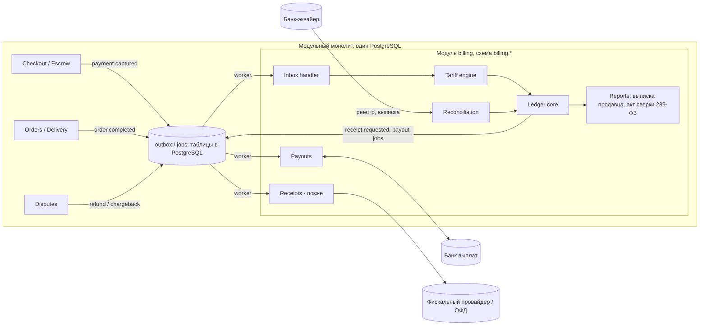

# 04. Альтернативы и запасные варианты

Основной дизайн — в `03-high-level-design.md`. Здесь варианты, которые рассмотрены и отложены, с условиями, при которых к ним стоит вернуться.

## 1. Запасная архитектура: модульный монолит

**Когда выбирать:** если биллинг не будет отдельным продуктом и нужен только нашей платформе. Например, если продажу биллинга другим компаниям отменят или отложат надолго.

Вся платформа — **модульный монолит** (NestJS) с одним PostgreSQL. `billing` — модуль со **своей схемой** (`billing.*`) и своей ролью БД. Другие модули не читают и не пишут его таблицы и общаются с ним только событиями через outbox и публичный интерфейс модуля.

Почему в этом случае не отдельный сервис:

- при ~116 продажах в секунду (§2 в 03) распределённая система ничего не даёт, а добавляет сеть, ретраи и распределённые операции с деньгами;
- одна БД позволяет класть событие в outbox **атомарно** с бизнес-изменением (оплата в checkout) без брокера;
- граница модуля (своя схема плюс общение только событиями) позволяет вынести billing в отдельный сервис позже, поменяв только транспорт.

Отличия в потоках от основного варианта:

- продажа: worker берёт из общего outbox событие `payment.captured`, которое checkout записал в одной транзакции с оплатой; повтор отсекается inbox-таблицей по `event_id`;
- не нужны `tenant_id`, API-ключи, вебхуки, сверка «платформа ↔ биллинг»;
- баланс продавца кабинет читает напрямую из модуля billing, без копии.

**Сравнение с основным вариантом:**

| | Монолит (запасной) | Отдельный продукт (основной, 03) |
|---|---|---|
| Интеграция | Вызов модуля + outbox в одной БД | HTTP API + вебхуки, outbox на обеих сторонах |
| Атомарность «оплата + проводка» | Одна транзакция БД | Eventual consistency, нужна сверка «платформа ↔ биллинг» |
| Мультиарендность | Не нужна | `tenant_id`, RLS, лимиты, ключи |
| Скорость старта | Быстрее | Медленнее (контракт API, вебхуки, документация) |
| Можно продавать | Нет | Да |

## 2. Кто принимает платежи: платформа (v1) или биллинг (v2)

**Вариант 1 — платформа (основной, §3.4 в 03).** Платёжную форму, договор с эквайером и вебхуки банка держит платформа. Она сообщает биллингу о продаже вызовом `POST /v1/sales/captured`, биллинг проверяет факт сверкой с реестром эквайера платформы.

**Вариант 2 — биллинг (v2).** Платформа синхронно просит биллинг создать платёж и получает ссылку на платёжную форму. Вебхуки банка приходят в биллинг. Получается законченный продукт «платежи + учёт + выплаты», как Stripe Connect.

### 2.1. Сравнение

| Критерий | 1. Платформа принимает | 2. Биллинг принимает |
|---|---|---|
| Источник факта оплаты | Платформа. Биллинг **верит ей до сверки** с реестром эквайера (D+1) | Банк напрямую. Биллинг сам знает, что деньги пришли |
| Критический путь продажи | Биллинг вне его: биллинг лёг — платформа продаёт, вызовы копятся в её outbox | Биллинг в нём: биллинг лёг — платформа не продаёт. Нужен SLA 99.95%+, резервирование, дежурства |
| Регуляторика | Биллинг не трогает деньги покупателей: не платёжный агент, не агрегатор | Компания-биллинг принимает деньги физлиц за чужие товары: платёжный агент или агрегатор (103-ФЗ, 161-ФЗ), ПОД/ФТ (115-ФЗ), KYC продавцов. Либо строго через номинальные счета банка-партнёра |
| PCI DSS | Не касается биллинга | Только платёжная страница банка или PSP (hosted payment page). Если карты пойдут через биллинг — нужна сертификация |
| Кассы (54-ФЗ) | Чек от имени платформы (её ККТ). Биллинг может пробивать его как функцию (§8 в 03) | То же, плюс у биллинга как платёжного агента появляются собственные обязанности по ККТ |
| Где лежат деньги | На счёте платформы (номинальном). Биллинг одобряет выплату, платформа исполняет её сама и сообщает результат | На счёте биллинга или банка-партнёра. Выплаты из своей инфраструктуры |
| Сверка с эквайером | Платформа должна передавать реестры эквайера (или доступ к ним). Добавляется пара сверки «платформа ↔ биллинг» | Полностью внутри биллинга, платформе ничего передавать не нужно |
| Разблокировка денег продавцу | Только после того, как платёж найден в реестре эквайера | Сразу по вебхуку банка (холд и резерв по тарифу как обычно) |
| Подключение платформы | Платформа оставляет своего эквайера и договор с банком — проще продать | Платформа переезжает на эквайринг биллинга: дольше, но один договор на всё |
| Ценность продукта и цена | Только учёт и выплаты — дешевле | Законченный продукт «платежи + учёт + выплаты» — дороже, можно брать долю MDR |
| Возвраты и chargeback | Инициирует платформа, сообщает биллингу через API | Инициирует и получает биллинг. Платформа должна асинхронно реагировать на вебхуки биллинга |
| Сложность первой версии | Ниже: нет интеграции с банком, нет лицензий | Выше: интеграция с эквайером, отказоустойчивость, юридическая подготовка |

### 2.2. Подводные камни

**Вариант 1 (платформа принимает):**

- платформа может прислать ошибочную или поддельную продажу. Защита: деньги продавцу доступны только после совпадения с реестром эквайера, расхождение — инцидент;
- разные эквайеры у разных платформ: нужен парсер реестра под каждый банк (или платформа присылает реестр в нашем формате);
- выплату исполняет платформа, и биллинг узнаёт о результате с её слов: защита — сверка списаний по выписке её банка по `payout_id`; платформа может затягивать выплаты продавцам — биллинг видит это по зависшим `approved` и может показывать продавцу статус;
- двойной учёт: продажа и в базе платформы, и в биллинге. Расхождения ловит ежедневная сверка «платформа ↔ биллинг».

**Вариант 2 (биллинг принимает):**

- без банка-партнёра с номинальными счетами или лицензии запускать нельзя: это юридический, а не технический блокер;
- отказ биллинга останавливает продажи у **всех** платформ сразу;
- переход платформы с варианта 1 на 2 — миграция эквайринга и денег на счетах, нужен период, когда работают оба;
- биллинг отвечает перед покупателями и банком за мошенничество продавцов платформы (chargeback-рейтинг, штрафы платёжных систем).

### 2.3. Когда переходить на вариант 2

Когда есть банк-партнёр с номинальными счетами (или лицензия) и платформы готовы платить за приём платежей. API продаж при этом не ломается: событие о продаже начинает создаваться внутри биллинга, а не приходить от платформы. Оба варианта могут жить одновременно — настройка платформы.

## 3. Брокеры сообщений

Внутри биллинга на старте очередь — PostgreSQL (§3.8 в 03). Сравнение вариантов:

| Вариант | Плюсы для нас | Минусы для нас |
|---|---|---|
| Kafka | Replay из лога, порядок в партиции (`seller_id`), много независимых потребителей (чеки, отчёты, аналитика), CDC через Debezium | Тяжёлая эксплуатация. Нет ack, retry и DLQ на уровне сообщения (нужны retry-топики), нет отложенных сообщений. При ~116 tps это overkill |
| RabbitMQ | Ack на сообщение, DLX, retry, маршрутизация, отложенная доставка (TTL или плагин). Хорош для команд «отправь выплату», «пробей чек», «доставь вебхук» | Сообщение исчезает после обработки (replay только через Streams). Порядок гарантирован только при одном потребителе очереди |
| BullMQ (Redis) | Есть в стеке вакансии. Retry с backoff, delay, rate-limit (лимиты API банка и облачной кассы), простой код | Надёжность Redis (AOF, `noeviction`). Это допустимо, только если задачу можно восстановить из состояния в PostgreSQL |
| PostgreSQL как очередь (outbox + `FOR UPDATE SKIP LOCKED`, pg-boss / graphile-worker) | Задача пишется **в той же транзакции**, что и проводки, без dual-write. Ноль новой инфраструктуры. 116 tps для Postgres мелочь | Нагрузка на основную БД, нужен vacuum. Не подходит как общая шина для многих сервисов |

**Когда добавлять брокер** (транспорт меняется, outbox остаётся источником):

- **RabbitMQ** — когда биллинг сам делится на сервисы (например, отдельный сервис доставки вебхуков) или когда доставка вебхуков многим платформам перестаёт помещаться в PostgreSQL-очередь;
- **Kafka** — когда у событий появится много независимых потребителей (аналитика, антифрод) и понадобится перечитывать историю;
- **BullMQ** — если Redis уже есть для кеша, а лимиты внешних API удобнее держать его rate-limiter'ом;
- в любом случае — если нагрузка вырастет до тысяч событий в секунду или аналитику нельзя увести с основной базы.

## 4. Общая шина между платформой и биллингом

Вариант: платформа и биллинг обмениваются событиями через общий RabbitMQ.

**Почему отклонён:** биллинг продаётся внешним компаниям, а они к нашему брокеру не подключатся (сеть, доступы, изоляция платформ, версия брокера становится частью продукта). Тогда у биллинга было бы два контракта: шина для нашей платформы и API для внешних. Внешний контракт никто бы не проверял на себе.

**Когда вернуться:** если биллинг останется внутренним (тогда см. скорее §1, монолит) или если крупная платформа попросит потоковую выдачу событий. Тогда это дополнительный канал поверх того же outbox, а не замена вебхуков.

## 5. Периодическая рассылка всех балансов платформе

Вариант: раз в X продаж или раз в X секунд биллинг шлёт платформе текущие балансы продавцов.

**Идея правильная по сути** (у платформы копия для показа), но в таком виде есть проблемы. Основной вариант (§3.6 в 03) их исправляет:

| Проблема | Почему | Исправление в основном варианте |
|---|---|---|
| «Все балансы раз в X секунд» | Шлём миллионы неизменившихся балансов. Растёт трафик и нагрузка на серверы платформ | Слать **только изменившиеся** балансы |
| «Раз в X продаж» | Баланс меняется и без продаж (освобождение резерва). У продавца с редкими продажами копия не обновится | Триггер — изменение баланса |
| Порядок доставки | Старый баланс может прийти позже и перезаписать новый | `version` в сообщении, сохранение только более новой версии |
| Потерянное сообщение | Копия навсегда отстанет | Полный снимок раз в сутки как сверка, `GET /v1/balances?updated_since=` |
| Решения по копии | Вывод по копии даёт риск двойного вывода | Копия только для показа, вывод — синхронный API |

## 6. Биллинг сам исполняет выплаты через банк платформы (connector)

Вариант: платформа выпускает в кабинете своего банка или PSP ключ (или даёт OAuth-согласие) с правом «только выплаты» и передаёт биллингу. Биллинг сам вызывает API выплат, платформа в цепочке не участвует.

| | |
|---|---|
| **Плюсы** | Платформе не нужно писать исполнитель выплат. Выплата идёт за минуты без участия платформы. Статус биллинг получает от банка напрямую, а не со слов платформы |
| **Минусы** | Сторонний сервис получает право двигать деньги платформы: платформы (и их банки, служба безопасности) часто на это не согласны. Биллинг хранит секреты всех платформ — утечка у нас означает доступ к деньгам многих компаний. Под каждый банк и PSP свой коннектор. Некоторые банки требуют электронную подпись платежей, и полная автоматизация невозможна |
| **Почему не основной** | Решение «кому и сколько» отделено от «двигать деньги» и без этого. Исполнение у платформы проще продать и безопаснее для обеих сторон (§3.4 в 03) |

**Когда вернуться:** как платная опция для платформ, которые сами просят «сделайте всё за нас», и только для провайдеров, где у ключа можно ограничить права и лимиты.

## 7. Вопросы Артёму по вариантам

1. Есть ли у компании банк-партнёр, номинальные счета или лицензия? От этого зависит, когда реален v2 (приём платежей биллингом).
2. Какой SLA нужен биллингу, если он окажется на критическом пути продажи?
3. Модель монетизации биллинга: процент от оборота, фикс за транзакцию, подписка? От этого зависит учёт собственного дохода биллинга.
4. Будет ли биллинг пробивать чеки от имени платформ как платную функцию, или платформы делают это сами по данным из вебхука?
